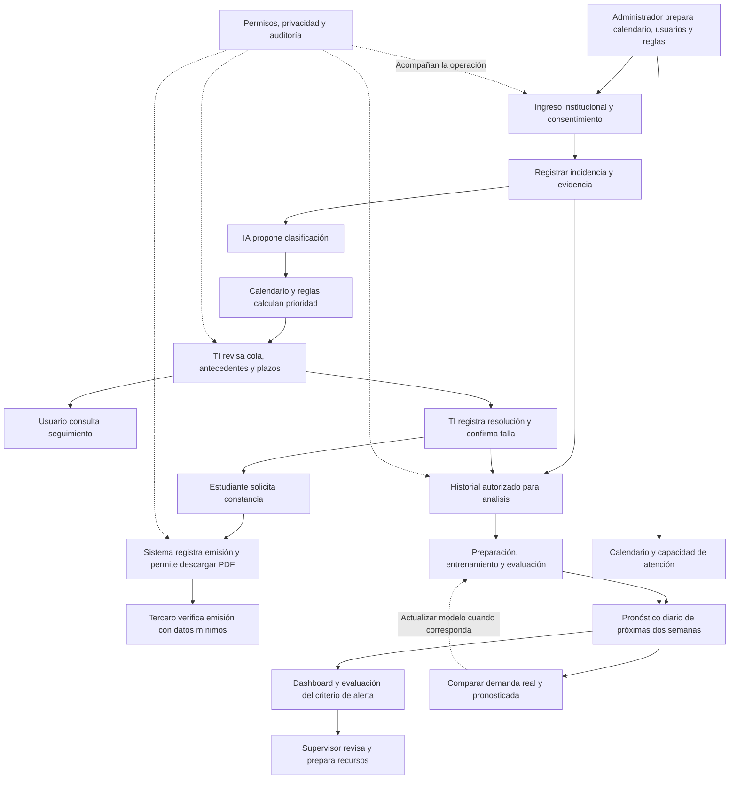

# CampusITSM — Tres casos de uso y catálogo de pantallas

> Catálogo conceptual de referencia. Los planes vigentes actualizan su reparto:
> P01/Supabase Auth y autorización común corresponden a Roberto; Jasmine conserva
> administración, consentimiento y auditoría. El diseño aprobado reutiliza los
> componentes de casos-gestion: ver [guía compartida](../../docs/DISENO_COMPONENTES.md).
> Las láminas conservan estructura y funciones; sus datos son ilustrativos.

Propuesta visual del 6 de noviembre de 2026. Mockups conceptuales de escritorio, no aplicación implementada. Basada en el documento académico, PROYECTO.md y la imagen de referencia del usuario. Las pantallas de soporte se agrupan en tres casos amplios para respetar el máximo solicitado; no son tres operaciones atómicas de UML.

## Dirección visual

Conservar el estilo de la referencia: blanco, gris frío muy claro, verde institucional y menta; tipografía sans serif, iconos de línea, menú lateral estrecho, cabecera con buscador, tarjetas con bordes sutiles y sombras suaves, tablas y gráficos legibles. Marca propuesta CampusITSM y subtítulo Universidad Privada Tallán, institución ficticia del caso. No confundirla con la universidad del curso. Menús y datos adecuados al rol; sin dashboard global para estudiantes. Escritorio primero, sin definir todavía todas las variantes móviles. No se incorpora Reiniciar demo a la navegación ordinaria.

## CU01 — Registrar, priorizar y atender una incidencia

**Actores:** estudiante/docente, agente de TI; servicios de identidad, clasificación y calendario.

**Disparador:** un usuario encuentra una falla que afecta una actividad académica.

**Precondiciones:** usuario autorizado; calendario disponible o caso marcado para revisión; categorías y reglas de atención configuradas.

**Flujo:** (1) iniciar sesión y registrar consentimiento; (2) describir problema y adjuntar evidencia opcional; (3) guardar reporte y generar identificador; (4) IA propone categoría, urgencia e impacto según la especificación del repositorio; (5) consultar eventos correspondientes al curso/usuario; (6) calcular U×I×factor y prioridad; (7) ordenar cola; (8) TI consulta antecedentes y puede ajustar con justificación; (9) registrar atención y seguimiento; (10) guardar resolución y confirmación de falla.

**Alternativas propuestas:** si falla la IA o el calendario, conservar reporte y derivar a revisión de TI; rechazar adjuntos inválidos sin perder los demás campos; accesos sin autorización no muestran información del ticket. No se promete resolución automática por IA.

**Resultado:** ticket trazable, con estado, responsables, tiempos y evidencias; elegibilidad para constancia cuando corresponda.

**Pantallas:** P01–P08.

## CU02 — Obtener y verificar una constancia

**Actores:** estudiante, sistema, tercero verificador (docente o Área académica).

**Disparador:** estudiante solicita respaldo de una falla atendida.

**Precondiciones:** ticket resuelto y falla confirmada por TI según PROYECTO.md; persona autorizada sobre ese ticket.

**Flujo:** (1) consultar constancias; (2) solicitar emisión; (3) comprobar condiciones; (4) generar y registrar PDF y código; (5) descargar; (6) compartir QR/código; (7) verificador consulta emisión pública con datos mínimos.

**Alternativas:** solicitud aún no habilitada; código inexistente o no válido; emisión con error. La verificación del contenido de un archivo alterado deberá diseñarse explícitamente y no se presume por solo escanear un QR.

**Resultado:** constancia emitida o motivo claro de no emisión; consulta pública sin exponer evidencias ni información personal completa.

**Pantallas:** P09–P12. El mockup usa Firma institucional · prototipo y QR ilustrativo, sin afirmar firma digital certificada. El alcance de firma definitiva debe unificarse con el Word. No concede automáticamente reprogramación de exámenes.

## CU03 — Anticipar demanda y administrar la operación de TI

**Actores:** supervisor de TI, administrador, proceso programado y modelo predictivo.

**Disparadores:** análisis diario; revisión de alerta; mantenimiento de calendario, reglas o permisos.

**Precondiciones:** histórico autorizado preparado para análisis, calendario y capacidad de atención definidos, modelo evaluado temporalmente; permisos de supervisor o administrador.

**Flujo principal:** (1) administrar calendario y usuarios; (2) configurar factores, SLA y capacidad; (3) preparar datos analíticos; (4) entrenar/evaluar modelo; (5) diariamente pronosticar demanda de próximas dos semanas; (6) guardar pronóstico y mostrar incertidumbre cuando esté disponible; (7) comparar con criterio de alerta; (8) notificar al supervisor; (9) revisar y decidir refuerzo; (10) comparar demanda real y pronosticada para evaluar actualización. Los accesos y cambios relevantes quedan auditados.

**Alternativas propuestas:** datos insuficientes o modelo sin evaluación muestran estado no disponible y revisión requerida; calendario importado con errores se valida antes de publicar; capacidad no configurada impide afirmar sobrecarga por capacidad; alertas repetidas necesitan política por definir.

**Resultado:** pronóstico y alerta trazables, decisión humana sobre recursos y administración con permisos.

**Pantallas:** P13–P24. Administración, privacidad y auditoría son pantallas de soporte de este caso amplio.

## Reglas y datos de demostración

- Ticket T-2026-1048, estudiante Johan, servicio Aula virtual – Acceso, examen Redes I a las10:30, registro10:02, resolución10:18. U3×I2×factor2=12, P1. Fechas ficticias del 06/11/2026.
- P1≥9: respuesta15min, resolución2h. P2≥5y<9:1h/4h. P3≥3y<5:4h/24h. P4<3:8h/72h.
- Factor regular1, entrega<48h1.5, matrícula1.7, examen<24h2. Aplicar el mayor cuando corresponda.
- La IA clasificadora y el modelo de demanda son componentes distintos. La predicción no cambia automáticamente la prioridad individual.
- Pronóstico ilustrativo500tickets/semana frente a capacidad350tickets/semana. Estas cifras, gráficos y métricas de evaluación son ejemplos de diseño, no experimentos ejecutados.
- No presentar satisfacción ni mejoras académicas o de SLA sin datos que las sostengan.

## Decisiones pendientes y ampliaciones de diseño

- Institucional: proveedor de identidad; relación usuario/curso/examen; integración académica real; horarios y cómputo de SLA; reapertura/cierre y asignación de agente.
- IA: categorías, validación de propuestas, fallos y tiempos de respuesta; modelo de pronóstico, umbral de alerta, capacidad y frecuencia de reentrenamiento. SARIMAX sigue siendo candidato sugerido, no decisión final.
- Constancias: firma final y mecanismo para detectar alteraciones del PDF; datos públicos y condiciones de emisión.
- Operación: correo frente a notificación interna; retención y anonimización; auditoría protegida; criterio Examen inminente pendiente.
- Las vistas de evaluación del modelo, revisión de alertas, matriz de permisos y centro de notificaciones concretan requisitos generales; sus controles detallados son propuestas para revisar.
- Se diseñan pantallas principales y cuatro estados de proceso/públicos visibles. No equivale a todas las variantes posibles de error, permisos, móvil, carga y vacío; deberán detallarse al implementar.

## Flujo general integrado

## Responsabilidad por rol

| Rol | Vistas principales | Alcance propuesto |
| --- | --- | --- |
| Estudiante/docente | P02–P06; P09–P10 según elegibilidad | Solo sus reportes y evidencias; constancias del estudiante según lo definido en el documento |
| Agente de TI | P07–P08 | Tickets del alcance autorizado; clasificación revisable, seguimiento y resolución |
| Supervisor | P13–P16, P24 | Demanda, evaluación, alertas y operación autorizada |
| Administrador | P17–P23 | Configuración y gobierno; acceso analítico según matriz final |
| Verificador público | P11–P12 | Consulta mínima de emisión; sin acceso al ticket ni a sus evidencias |

P01 es acceso y consentimiento compartido. El calendario y las notificaciones pueden tener vistas limitadas por rol; se diseña la vista administrativa y el centro supervisor, sin habilitar menús globales al estudiante.

## Catálogo y láminas

### Lámina 1 — CU01 · Ingreso y reporte

- P01 · Acceso institucional
- P02 · Inicio del estudiante
- P03 · Nueva incidencia
- P04 · Reporte recibido y clasificación

Imagen final: 01_cu01_ingreso_reporte_v2.png

### Lámina 2 — CU01 · Seguimiento y atención

- P05 · Mis incidencias
- P06 · Seguimiento de incidencia
- P07 · Cola priorizada de TI
- P08 · Atención y resolución de ticket

Imagen final: 02_cu01_seguimiento_atencion_v2.png

### Lámina 3 — CU02 · Constancias y verificación

- P09 · Mis constancias
- P10 · Constancia emitida y vista previa
- P11 · Verificación pública válida
- P12 · Verificación pública no válida

Imagen final: 03_cu02_constancias.png

### Lámina 4 — CU03 · Predicciones y alertas

- P13 · Dashboard de demanda
- P14 · Detalle de alerta predictiva
- P15 · Reportes y comparación
- P16 · Evaluación del modelo

Imagen final: 04_cu03_predicciones_alertas.png

### Lámina 5 — CU03 · Calendario y configuración

- P17 · Calendario académico
- P18 · Crear o importar evento
- P19 · Factores y tiempos de atención
- P20 · Usuarios y roles

Imagen final: 05_cu03_calendario_configuracion.png

### Lámina 6 — CU03 · Permisos, privacidad y auditoría

- P21 · Matriz de permisos
- P22 · Consentimientos y anonimización
- P23 · Auditoría de accesos y cambios
- P24 · Centro de notificaciones

Imagen final: 06_cu03_permisos_privacidad_auditoria_v2.png

