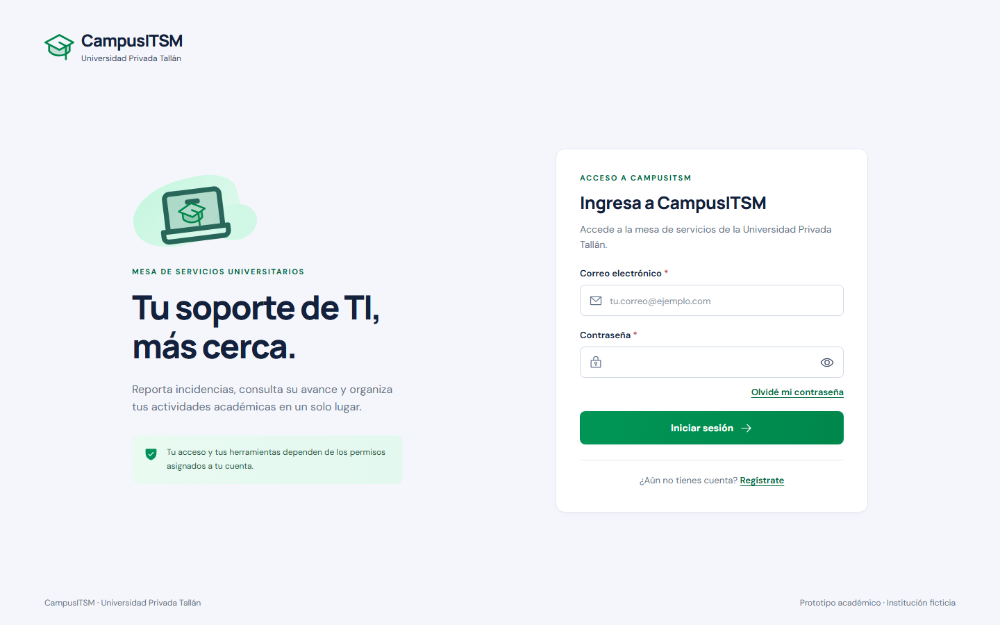
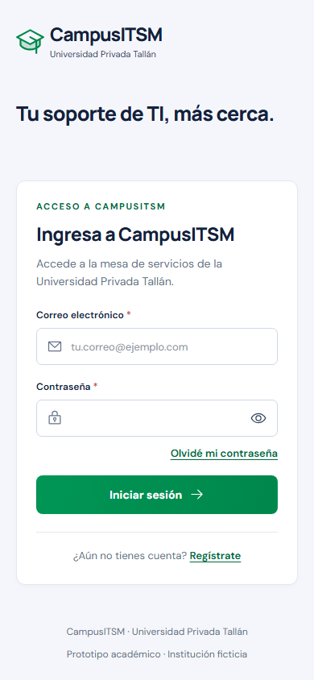
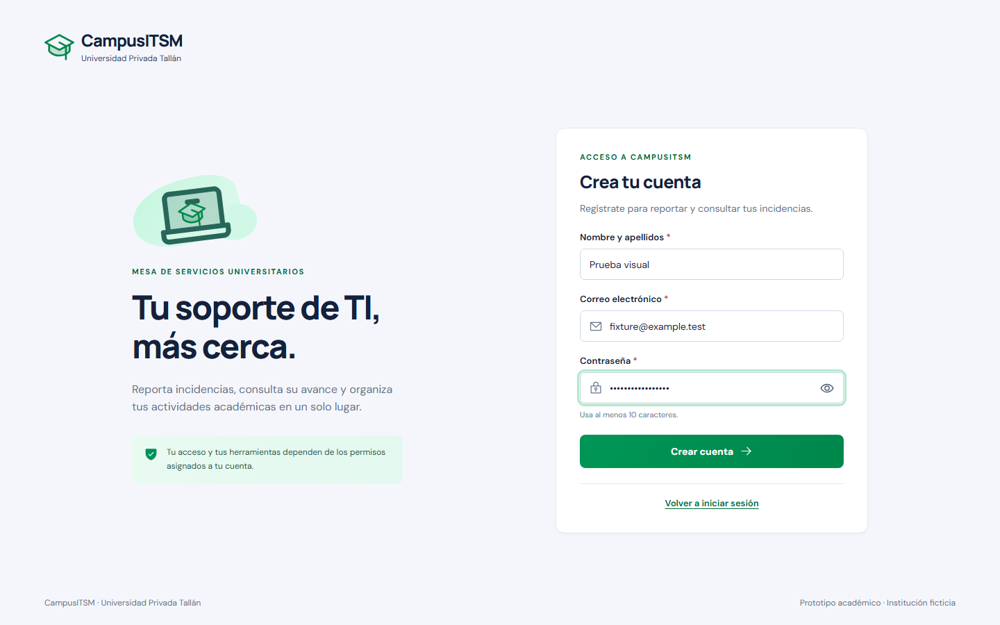

# Roberto — semana 1: identidad Supabase

Fecha: 7 de noviembre de 2026. Rama `identidad-supabase`, desde main
`02d10f557fdf81af81fdeef1ecf7fb7d210aaeed`. Trabajo todavía sin integrar en main.
No equivale al cierre de semana 1 ni implementa módulos de Johan/Jasmine.

## Resultado

Supabase Auth alojado creado en la organización elegida por Roberto, plan gratuito,
región São Paulo. [Panel CampusITSM](https://supabase.com/dashboard/project/npjibnlxepiwfermtcmo).
Credenciales de acceso en Supabase; negocio, perfiles y roles en PostgreSQL/Docker.
No se trasladaron las tablas del calendario ni se creó otra instalación de revisión.
Se conserva campusitsm y sus volúmenes en `http://localhost:8080`.

Roberto eligió registro propio. P01 admite registro, login, recuperación por enlace
y cambio de contraseña. El selector de roles de demostración se reemplazó por acceso
real, sin una segunda familia de componentes. Nombre/rol reales en la cabecera y
cierre de sesión. Calendario personal de solo lectura en `/calendario`; P17/P18
mantienen su autorización de administración.

Sesiones opacas HttpOnly/SameSite, CSRF/Origin, cifrado AES-256-GCM de tokens,
renovación serializada mediante bloqueos PostgreSQL y cambios de autorización
versionados. Un JWT decodificado o metadata de usuario nunca concede privilegios.
Registro nuevo siempre estudiante; primer administrador solo por herramienta local
explícita, con cuenta confirmada existente y registro atómico del cambio.

Contratos y OpenAPI actualizados; servicio común de permisos/alcances para los demás
módulos. Guía del equipo en [AUTH_DESARROLLO.md](../AUTH_DESARROLLO.md).

## Evidencia y límites

- GitHub consultado al iniciar: main/origin/main en `02d10f5`, sin cambios locales;
  única rama remota adicional `front-vistas`, conservada. No había módulos ajenos
  publicados de consentimiento/auditoría que integrar en ese momento.
- Construcciones TypeScript/Vite y Docker correctas. Migraciones aditivas aplicadas
  a la misma base local; la semilla conserva registros previos.
- Servidor: 20/20 pruebas del ejecutable conjunto aprobadas en la revisión final:
  calendario/identidad con PostgreSQL y contrato PKCE/mensajes del SDK oficial.
  El proveedor se sustituye únicamente en pruebas, sin crear rutas de acceso ficticio.
- Interfaz: 9/9 pruebas Playwright aprobadas, incluidos acceso denegado, estado de
  sesión después del login, logout, registro, recuperación y regresión de calendario.
- Supabase real: configuración de correo/registro consultada desde API con respuesta
  200. Registro de Roberto creó una cuenta; el error inicial fue email_not_confirmed,
  identificado en logs sin consultar contraseñas ni tokens. Roberto confirmó el correo
  y reportó login exitoso; se verificó una cuenta confirmada y un perfil/sesión locales.
- Roberto autorizó asignar su cuenta como administrador. La herramienta aplicó el
  cambio; después volvió a entrar y confirmó que puede abrir Crear evento.
- No se afirma haber guardado un evento con esa cuenta real: Roberto confirmó la
  apertura del formulario. Escrituras, persistencia y aislamiento se probaron con
  PostgreSQL y proveedor inyectado en el ejecutable de integración.
- Los recursos descartables de integración se cerraron y eliminaron al finalizar;
  no quedó otra aplicación web de prueba encendida.

## Revisión visual

Comparación con P01, arriba izquierda de la lámina final 01. Se conserva la estructura
de presentación/acceso, campos, acción verde y base visual aprobada. Registro y
recuperación se añadieron por la decisión actual de Roberto. No se impone un dominio
institucional ficticio como condición para probar con correos reales.

Se revisaron las capturas a 1440 × 900 y 390 × 844, sin desbordamientos. Se corrigió
el espacio del encabezado móvil. La política/aceptación de consentimiento del mockup
permanece pendiente de Jasmine; no se muestra una aceptación sin política real.

## Pendientes explícitos

1. Configurar un envío SMTP autorizado antes de ofrecer registro/recuperación a
   correos ajenos al equipo Supabase. El correo incluido tiene restricciones; no se
   desactivó la confirmación, ni se eligió un proveedor de pago, ni se otorgaron
   privilegios de Supabase a compañeros para eludir ese límite.
2. Jasmine entrega consentimiento y auditoría global. AcademicChange e IdentityChange
   ya registran cambios atómicos; faltan su consumo y las pantallas P20/P21.
3. Revisión de la rama e integración solo cuando Roberto lo autorice. Los compañeros
   no deben tratar esta entrega como publicada en main antes de esa integración.
4. Completar con cuentas reales de varios roles la demostración conjunta al contar
   con el envío de correo. La recuperación real por email y el cambio de contraseña
   no se ejecutaron sobre la cuenta de Roberto; están verificados automáticamente.

El aviso de Supabase sobre protección contra contraseñas filtradas permanece como
configuración del proyecto nuevo; no se cambió de plan para activarlo.
[Referencia de protección de contraseñas](https://supabase.com/docs/guides/auth/password-security#password-strength-and-leaked-password-protection).

No se iniciaron CSV, factores/SLA, IA, pronósticos, tickets, constancias ni publicación
pública. MEMORIA_PROYECTO.md conserva su fotografía histórica sin cambios rutinarios.
