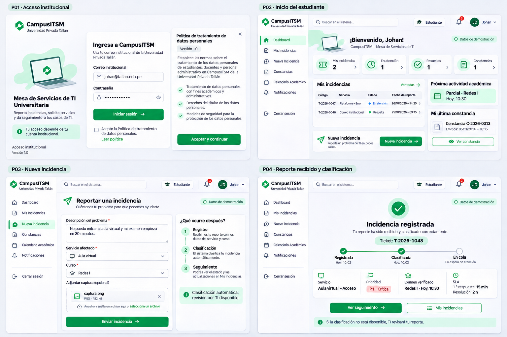
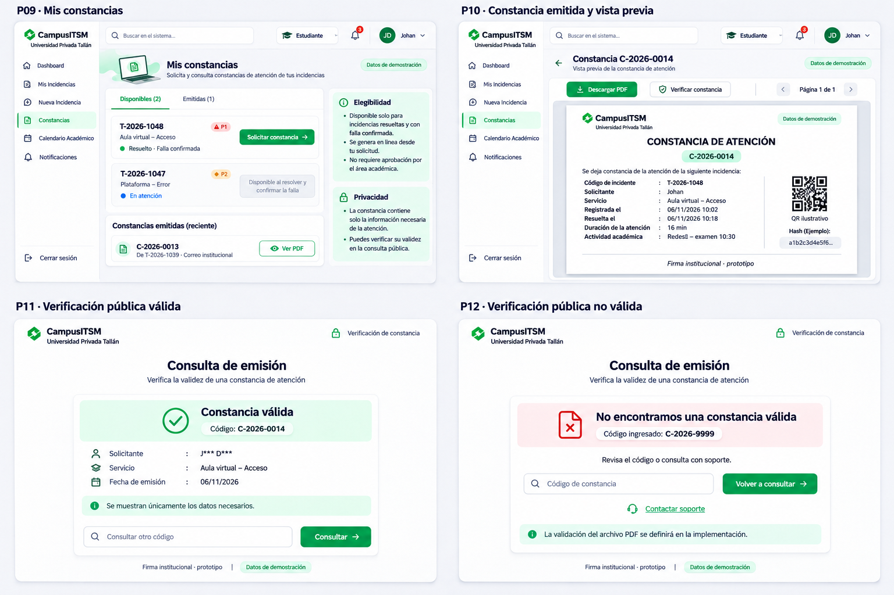
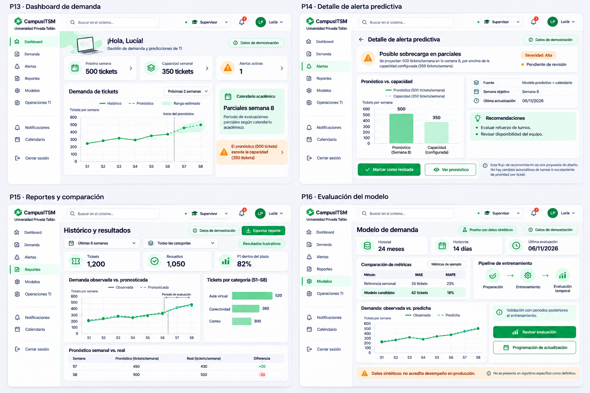
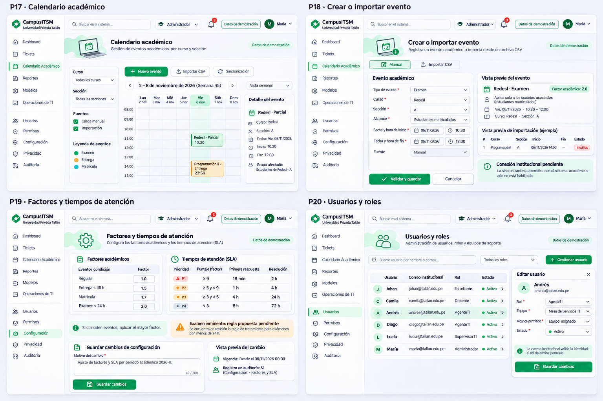
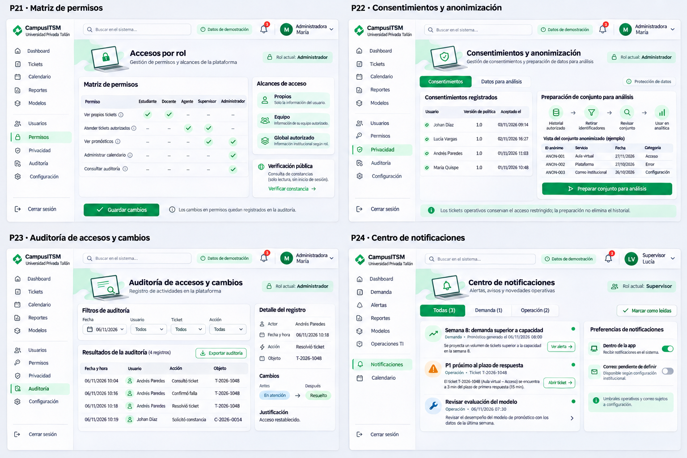

# Plan de implementación de CampusITSM para Jasmine

Este plan está dirigido exclusivamente a Jasmine y su agente. Eres responsable del frontend y backend de acceso, usuarios, permisos, constancias, privacidad, auditoría y reportes. Ejecuta únicamente la semana que Jasmine indique, con revisión antes de la siguiente.

## Contexto completo y alcance acordado

CampusITSM es una mesa de ayuda para la Universidad Privada Tallán, institución ficticia del caso académico. Tiene tres casos de uso:

1. **CU01:** usuario registra una incidencia y evidencia; el sistema clasifica, consulta el contexto académico y prioriza; TI atiende y resuelve; el usuario sigue el avance.
2. **CU02:** el titular solicita una constancia después de resolver y confirmar la falla; el sistema genera PDF/QR y permite verificar emisión y archivo.
3. **CU03:** se preparan datos históricos, se evalúa un modelo y se pronostica demanda; se generan alertas; supervisor y administrador preparan recursos y gobiernan el sistema.

El equipo es Roberto, Johan y Jasmine. Cada integrante hace frontend, backend y pruebas de sus módulos. Roberto coordina integración. Hay cuatro semanas relativas al inicio efectivo, sin fechas de calendario fijadas, con 11–20 horas semanales por persona. La cuarta semana se reserva principalmente para integración, pruebas y correcciones.

Este archivo es autocontenido: no requiere otra conversación ni otro plan individual. Los [casos de uso y catálogo](../diseno/campusitsm/CASOS_DE_USO_Y_PANTALLAS.md) son material complementario; las instrucciones actuales acordadas aquí actualizan las decisiones abiertas de ese catálogo.

**Primera versión:** aplicación local completa en Docker, una institución y un equipo de soporte, cuentas propias, calendario manual/CSV, PDF verificable y notificaciones dentro de la aplicación. No se incluye todavía inicio de sesión institucional externo, integración académica real, correo, firma digital certificada, reapertura/cierre adicional, multiinstitución ni publicación en servidores. Esas ampliaciones no deben bloquear la entrega local.

La clasificación por IA y el pronóstico son componentes distintos. El proveedor con opción gratuita de clasificación se elegirá con Roberto cuando llegue ese módulo; no asumir que un proveedor sigue siendo gratuito ni contratarlo unilateralmente. El pronóstico se ejecutará localmente en Python.

### Stack único

| Capa | Decisión |
| --- | --- |
| Frontend | React + Vite + TypeScript; React Router para navegación; TanStack Query para datos del servidor |
| Diseño | Componentes reutilizables, CSS con tokens comunes, Lucide para iconos y Recharts para gráficos |
| Backend | Una API NestJS modular en TypeScript, prefijo `/api/v1`, contratos OpenAPI |
| Persistencia | Una base PostgreSQL por instalación, Prisma y migraciones versionadas |
| Predicciones | Python con pandas y statsmodels, expuesto solo al backend mediante servicio interno |
| Tareas | pg-boss sobre PostgreSQL; tareas persistentes sin añadir Redis en esta versión |
| Ejecución | Docker Compose con servicios `web`, `api`, `db`, `predictions`, más inicialización de migraciones/datos |
| Actualizaciones | Eventos del servidor para tickets/notificaciones; al reconectar se vuelve a consultar estado actual |
| Pruebas | Pruebas unitarias de dominio, integración con PostgreSQL, recorridos Playwright y comprobación visual |

La infraestructura compartida debe fijar versiones compatibles y archivos de bloqueo, configuración de ejemplo sin secretos, salud y volúmenes para datos, archivos y modelos. Las claves solo se configuran en el servidor. No conectar React directamente a PostgreSQL o Python.

### Estado inicial verificado el 6 de noviembre de 2026

Repositorio: `https://github.com/RobertoC1006/proyecto-gestion.git`.

- `main` local y en GitHub: `1501f5aaec13a77f3ebb79da52bf50d66e4e6678`; contiene únicamente README.
- `front-vistas` en GitHub y referencia `origin/front-vistas`: `a4896261f92507155f5f153f7476fd29d99d631b`.
- El frontend existe en `front-vistas`: React/Vite/TypeScript, componentes, cuatro tickets ficticios y vistas mayormente estáticas.
- El documento `PROYECTO.md` está en esa rama; todavía menciona Next.js, seis integrantes y decisiones anteriores. Roberto debe actualizarlo a lo acordado aquí.
- Los diseños y estos planes se preparan en carpetas locales que inicialmente no están publicadas. Su existencia en la computadora de Roberto no demuestra que los compañeros los tengan.
- Todavía no hay backend NestJS, Docker, PostgreSQL conectado ni IA real en el código revisado.

Esta es una fotografía de origen, no una condición permanente. El agente debe comprobar la situación real antes de cada avance; no sobrescribir trabajo posterior para volver a estos commits.

## Trabajo coordinado sin duplicación

### Responsables y límites

| Responsable | Propiedad principal | Pantallas propias |
| --- | --- | --- |
| Roberto | Docker, esquema/migraciones, contratos comunes, calendario/configuración, predicción y notificaciones | P13, P14, P16, P17, P18, P19, P24 |
| Johan | Componentes visuales compartidos, tickets, prioridad, seguimiento, atención y clasificación | P02, P03, P04, P05, P06, P07, P08 |
| Jasmine | Identidad, permisos, consentimiento, constancias, privacidad, auditoría y reportes | P01, P09, P10, P11, P12, P15, P20, P21, P22, P23 |

Reutilizar primero `AppHeader`, `Sidebar`, `PriorityBadge` y las vistas existentes; mejorarlos de manera coordinada. Crear una sola familia compartida de formularios, botones, tablas, tarjetas, filtros, diálogos y estados. No duplicar módulos para poder avanzar.

Las reglas viven en servicios NestJS, no en componentes React. Las vistas solicitan acciones y muestran resultados. Python recibe datos analíticos y no replica la prioridad de los tickets.

### Contratos y archivos compartidos

Roberto publicará `PROYECTO.md` actualizado, `docs/CONTRATOS.md` y `docs/ESTADO_EQUIPO.md` al entregar la base. Son archivos a crear, no prerrequisitos ya existentes. El último registra base utilizable, commit, ramas/responsables y dependencias pendientes.

Contratos mínimos que deben acordarse antes de implementar sus consumidores:

| Dominio | Responsable | Capacidades públicas/internas que debe proporcionar |
| --- | --- | --- |
| Identidad | Jasmine | Login/logout, usuario actual, rol, permisos, equipo, consentimiento y autorización por objeto |
| Contexto académico | Roberto | Cursos/secciones y asociaciones; eventos aplicables al usuario/curso/fecha; factor y motivo; configuración versionada de SLA |
| Tickets | Johan | Crear/listar/consultar con permisos, adjuntos, asignación, clasificación/ajuste, historial, plazos, resolución y confirmación de falla |
| Constancias | Jasmine | Elegibilidad, emisión idempotente, PDF privado, consulta pública mínima y comprobación de archivo |
| Analítica | Roberto | Series observadas, pronósticos, modelos/evaluaciones, unidades, periodo, fuente y capacidad configurada |
| Reportes | Jasmine | Presentación/exportación autorizada usando consultas y resultados analíticos comunes, sin un segundo cálculo de prioridad/pronóstico |
| Notificaciones | Roberto | Publicar avisos por destinatario, listar, marcar leídos, alertas revisables y eventos para actualización |
| Auditoría | Jasmine | Registrar actor, instante, acción, objeto y cambios; lectura/exportación autorizadas, sin edición desde la aplicación |

Los nombres concretos de rutas y DTO se fijan en `docs/CONTRATOS.md` antes de desarrollar pantallas consumidoras. Identificar estados, campos obligatorios, permisos, paginación, errores y ejemplos. Compartir tipos desde OpenAPI, no copiar modelos Prisma al navegador. No tratar un contrato propuesto en otra rama como si ya estuviera integrado.

Roberto administra archivos globales y migraciones; Johan, componentes y navegación compartidos; Jasmine, identidad y auditoría. Solicitar cambios a su responsable y obtener la actualización acordada antes de introducir otra implementación. Las migraciones pendientes se revisan secuencialmente sobre `main`; nunca editar una migración ya aplicada para resolver un conflicto.

### Revisión de ramas antes de trabajar

Hacer esta revisión al iniciar una sesión, al comenzar un módulo, al recibir una entrega y antes de integrar:

1. Revisar `git status --short --branch`; identificar trabajo propio y ajeno sin confirmar. No descartarlo, guardarlo automáticamente ni cambiar de rama con modificaciones que puedan perderse.
2. Actualizar referencias con `git fetch origin --prune` y consultar `git branch -a -vv` y el historial de `origin/main`. Si no hay red, registrar que no se verificó GitHub; no afirmar que se está actualizado.
3. Revisar diferencias de la rama de trabajo frente a `origin/main` y los cambios recientes de ramas activas de los compañeros con `git log`, `git diff` y `git show`, sin modificarlas.
4. Leer `PROYECTO.md`, contratos, estado del equipo y entregas vigentes. Si aún no existen, distinguir la base pendiente de un archivo eliminado por error.
5. Confirmar que la funcionalidad requerida no existe ya ni está siendo implementada por otra persona. Anotar dependencias de contratos no integrados.
6. Actualizar la rama mediante integración normal de `origin/main`, resolver conflictos sin pisar trabajo ajeno y repetir las comprobaciones afectadas.

Leer una rama ajena no autoriza a hacer checkout sobre su trabajo local, fusionarla, copiar servicios todavía no acordados o eliminarla. No utilizar `reset --hard`, borrado forzado o push forzado como limpieza rutinaria.

### Ciclo de ramas por módulo

Crear cada rama desde `main` actualizado; un módulo puede continuar entre semanas. Los nombres no llevan `codex/` ni prefijos similares. Puede haber tres ramas de módulo activas, una por integrante.

Entregar commit y PR a Roberto. Tras verificar e integrar, publicar `main`, comprobar que contiene todo el trabajo del módulo y eliminar únicamente esa rama local y remota. Usar borrado local normal, sin forzarlo. Nunca borrar `main`, una rama de otro integrante o una rama con cambios pendientes.

La limpieza se hace por módulo, no por calendario. Si un módulo sigue abierto, conservar su rama; no borrar trabajo para aparentar una entrega semanal. No iniciar el módulo dependiente hasta que su base esté disponible.

## Reglas comunes del sistema

- Roles: `estudiante`, `docente`, `ti_agente`, `ti_supervisor`, `administrador`. El servidor determina el rol; no se eligen privilegios desde el encabezado.
- Estudiante/docente ven sus casos; agente, tickets del equipo autorizado; supervisor, operación/analítica autorizada; administrador, configuración/gobierno. Público solo consulta mínima de constancias. Comprobar siempre permisos en la API y en descargas.
- Sesiones en PostgreSQL, contraseñas protegidas, cookies HttpOnly y protección de operaciones de escritura. No guardar credenciales ni datos de negocio en localStorage.
- Fechas guardadas en UTC, mostradas en `America/Lima`. SLA inicial continuo, sin descontar noches o feriados.
- Estados iniciales: `registrado`, `clasificado`, `en_atencion`, `resuelto`. Mantener estado de clasificación independiente si falta revisión. Confirmación de falla es un dato separado.
- Urgencia e impacto de 1 a 3. Factor: regular: 1; entrega con vencimiento futuro menor a 48 h: 1,5; matrícula en curso: 1,7; examen en curso o menor a 24 h: 2. Usar el máximo aplicable a ese usuario/curso.
- Puntaje = urgencia × impacto × factor. P1 ≥ 9; P2 ≥ 5 y < 9; P3 ≥ 3 y < 5; P4 < 3.
- Respuesta/resolución: P1 15 min/2 h; P2 1 h/4 h; P3 4 h/24 h; P4 8 h/72 h. Primera respuesta es atención humana, no el acuse o la clasificación.
- TI puede ajustar valores con motivo obligatorio y auditoría. Conservar antes/después e historial de plazos; no reiniciar el reloj para aparentar cumplimiento.
- Si falta IA o contexto confiable, conservar el ticket y derivarlo a revisión; no inventar factor, clasificación o prioridad baja.
- Adjuntos PNG/JPG/PDF de hasta 5 MB, validación del archivo, almacenamiento privado y descarga autorizada.
- Constancia del titular: ticket resuelto y falla confirmada. Emisión repetida no crea duplicados. PDF con QR real y huella final registrada; consulta pública con nombre enmascarado. La emisión no aprueba por sí misma una reprogramación.
- Predicción diaria a 14 días, referencia semanal frente a candidato SARIMAX, métricas calculadas y evaluación temporal. No aumentar automáticamente prioridades individuales por una alerta de demanda.
- Datos sintéticos separados/identificados. No atribuir eficacia real, satisfacción, cumplimiento o mejoras a las cifras de las imágenes.
- Auditoría desde las primeras operaciones; no registrar secretos ni contenido privado completo en logs.

La marca de la interfaz es CampusITSM, Universidad Privada Tallán. No confundir la institución ficticia con la universidad del curso.

## Fidelidad visual y reutilización

Las imágenes finales son la referencia de implementación, no inspiración para otro diseño. Examinar el cuadrante correspondiente sin los rótulos externos de la lámina. Implementar controles, datos, navegación y gráficos reales.

Conservar menú, cabecera, jerarquía, proporciones, verde/menta, superficies claras, bordes, sombras y estilo de iconos. Cambiar solamente ejemplos, textos ilustrativos y errores tipográficos cuando lo exija el funcionamiento. No copiar un QR ilustrativo o un gráfico como imagen: generar su contenido real.

Usar un viewport de escritorio de 1440 × 900 para las capturas de revisión; comparar cada pantalla con su cuadrante escalado. Comprobar también 390 × 844 para móvil: adaptación accesible del mismo diseño, sin inventar otro sistema visual. El agente debe abrir las capturas y revisar distribución, solapamientos, textos y controles; no basta una compilación correcta.

Cada cierre semanal debe adjuntar captura implementada, imagen de referencia y diferencias pendientes. Ninguna imagen de ejemplo prueba que la funcionalidad esté implementada.

## Pantallas propias y mockups exactos

| Pantalla | Resultado a implementar | Referencia y posición |
| --- | --- | --- |
| P01 Acceso institucional local | Login de cuentas propias y consentimiento; no selección libre de privilegios | Lámina 1, arriba izquierda |
| P09 Mis constancias | Disponibles, emitidas, elegibilidad y solicitud | Lámina 3, arriba izquierda |
| P10 PDF de constancia | Vista, descarga y datos de emisión reales | Lámina 3, arriba derecha |
| P11 Verificación válida | Página pública mínima con datos enmascarados | Lámina 3, abajo izquierda |
| P12 Verificación no válida | Código inexistente/no válido y nueva consulta sin datos privados | Lámina 3, abajo derecha |
| P15 Reportes y comparación | Indicadores, observado/pronosticado, categorías y exportación autorizada | Lámina 4, abajo izquierda |
| P20 Usuarios y roles | Listar, editar, activar/desactivar y asignar alcance autorizado | Lámina 5, abajo derecha |
| P21 Matriz de permisos | Permisos y alcances efectivos por rol | Lámina 6, arriba izquierda |
| P22 Consentimientos y datos analíticos | Versiones/aceptaciones y preparación de conjunto sin identificadores directos | Lámina 6, arriba derecha |
| P23 Auditoría | Filtros, detalle antes/después y exportación de registros de solo lectura | Lámina 6, abajo izquierda |

### Lámina 1 — P01

Archivo final: `01_cu01_ingreso_reporte_v2.png`. P02–P04 son de Johan.



### Lámina 3 — P09 a P12

Archivo final: `03_cu02_constancias.png`. Implementar las cuatro pantallas.



### Lámina 4 — P15

Archivo final: `04_cu03_predicciones_alertas.png`. P13, P14 y P16 son de Roberto.



### Lámina 5 — P20

Archivo final: `05_cu03_calendario_configuracion.png`. P17–P19 son de Roberto.



### Lámina 6 — P21, P22 y P23

Archivo final: `06_cu03_permisos_privacidad_auditoria_v2.png`. P24 es de Roberto.



## Antes de comenzar — Verificar Docker y contratos publicados

Roberto prepara y publica primero la base compartida en `main`. No generar otro backend o Docker propio incompatible.

1. Revisar cambios locales, referencias remotas, ramas activas y contexto vigente.
2. Obtener el commit de base publicado por Roberto, configuración de ejemplo y documentación.
3. Crear configuración local sin credenciales reales compartidas; construir los mismos servicios en tu Docker con `docker compose up --build`.
4. Verificar salud, migraciones y persistencia tras reinicio. La base y volúmenes son tuyos, no una conexión a la computadora de Roberto.
5. Coordinar modelo de usuarios, sesiones, consentimiento y auditoría antes de añadir endpoints consumidores.
6. Publicar pronto los contratos de identidad y autorización para que Johan y Roberto puedan conectar sus módulos.

Si falta la base o un contrato, revisar diseños y preparar pruebas/propuestas de esa semana. No habilitar rutas públicas, un selector de administrador o datos ficticios ocultos para presentar como terminada una conexión pendiente.

## Semana 1 — Identidad, consentimiento y usuarios básicos

**Rama:** `accesos-usuarios`.

### Backend y servicios compartidos

- Implementar cuentas administradas, hash de contraseñas, sesiones persistentes y cierre de sesión.
- Cookies HttpOnly, protección de escritura y controles de intentos de acceso. En el entorno local HTTP documentar su configuración; no prometer cifrado de producción.
- Obtener titular y permisos del servidor, no de valores editables en el navegador.
- Crear contratos de usuario actual y autorización por objeto que consuman compañeros.
- Administrar los cinco roles definidos y asociar agentes a equipo. Impedir eliminar/desactivar al último administrador.
- Registrar consentimiento explícito con versión y fecha. Una casilla no marcada no debe producir aceptación.
- Implementar servicio de auditoría inicial con actor, instante, acción, objeto y cambios permitidos, sin claves o archivos privados.
- Coordinar con Roberto migraciones y privilegios para proteger los registros de auditoría; la cuenta de aplicación no tendrá una ruta de modificación/borrado de esos registros.

### Pantallas

Completar P01 y P20 básico con componentes de Johan. El encabezado muestra el rol asignado, no concede privilegios al cambiar una opción visual. Administrar usuarios no equivale a crear una cuenta con rol arbitrario desde el login público.

### Aceptación

- [ ] Login/logout y sesión vencida funcionan; credenciales inválidas no revelan existencia de cuentas.
- [ ] Consentimiento conserva versión/instante y se puede consultar por el usuario autorizado.
- [ ] Estudiante no consulta tickets/adjuntos ajenos y no usa endpoints de administrador.
- [ ] Cambios de rol/estado quedan registrados y no dejan al sistema sin administrador.
- [ ] Johan/Roberto tienen contratos utilizables e integrados.
- [ ] P01/P20 básico reproducen los mockups y distinguen error/carga.

**Demostración:** ingresar como estudiante y administrador, comprobar menús/permisos y, con Johan integrado, registrar/consultar un reporte propio.

## Semana 2 — Emisión y verificación de constancias

**Rama:** cerrar acceso; después `constancias-verificables`.

### Backend

- Consumir la consulta autorizada de tickets de Johan. No copiar el ticket a otra tabla para mantener un estado alternativo.
- Centralizar en Constancias la elegibilidad: solicitante titular, resuelto y falla confirmada.
- Mantener una emisión reutilizable por ticket; solicitudes simultáneas o repetidas no producen múltiples documentos accidentalmente.
- Guardar snapshot de la atención y generar PDF real con código, servicio, instantes, duración, actividad y QR real.
- Usar `Firma institucional · prototipo`; no presentar un certificado legal inexistente.
- Para mostrar una huella dentro del PDF, usar una huella de datos canónicos de la constancia. Calcular por separado SHA-256 de los bytes finales y guardarlo en servidor para verificar el archivo: no intentar imprimir en el PDF su propia huella final.
- Descargar únicamente al usuario autorizado. El QR apunta a dirección configurable; para un teléfono, coordinar URL de red accesible con Roberto, no localhost.
- La consulta pública de código muestra nombre enmascarado, fecha y servicio, sin correo, adjuntos ni historial privado.
- Añadir comprobación de PDF frente a la huella registrada. Limitar tamaño, no conservar arbitrariamente archivos enviados por terceros y no confundir un código válido con prueba de que cualquier PDF está intacto.
- Registrar emisión y verificaciones relevantes con datos mínimos y publicar el aviso correspondiente mediante el servicio de Roberto cuando esté integrado.

### Frontend

P09 separa elegibles de emitidas y muestra claramente por qué un caso aún no permite solicitud. P10 renderiza el PDF generado, no una composición HTML fingiendo descarga. P11/P12 son públicas, sin sidebar ni avatar de sesión. Incluir en la consulta una acción clara para comprobar el archivo, conservando el diseño.

### Aceptación

- [ ] Un caso sin confirmar falla no permite emitir aunque esté resuelto.
- [ ] Cambiar el identificador no permite emitir/descargar una constancia ajena.
- [ ] El PDF se abre y se conserva idéntico para descargas de la misma emisión.
- [ ] El código válido encuentra emisión; el inexistente no muestra datos.
- [ ] El PDF original verifica y un cambio de bytes invalida su integridad.
- [ ] Un QR de emisión válido no hace que un archivo alterado sea aceptado.
- [ ] Repetir o hacer dos solicitudes simultáneas no duplica la emisión.
- [ ] P09–P12 conservan la estructura del mockup, sustituyendo QR/hash ilustrativos por reales.

**Demostración conjunta:** Johan resuelve/confirma; titular solicita; se descarga, escanea/consulta y compara archivo original frente a alterado.

## Semana 3 — Permisos, privacidad, auditoría y P15

**Ramas en secuencia:** `privacidad-auditoria` y `reportes-operativos`. Coordinar anticipadamente el contrato analítico; no dejar la consulta de P15 para el último día.

### Gobierno y privacidad

- Completar P20 y P21 con permisos efectivos, alcance propio/equipo/global autorizado y cambios registrados.
- Respetar el contrato de autorización que consumen compañeros; no sustituirlo por comprobaciones diferentes en cada pantalla.
- Completar P22: consulta de aceptaciones/versiones y preparación de un conjunto analítico sin identificadores directos.
- Excluir nombres, correos, adjuntos y texto libre identificable del conjunto usado para conteos/predicción. Conservar solo variables necesarias, agregadas cuando sea posible.
- La preparación no elimina tickets operativos ni permite acceso público a históricos.
- Completar P23: filtros por fecha/actor/objeto/acción, detalle antes/después y exportación limitada al alcance autorizado.
- No ofrecer edición/borrado de auditorías ni afirmar que un diseño visual garantiza registros inalterables.

### Reportes

- Consumir los servicios de Roberto para series observadas, pronósticos, fuente, periodo y métricas.
- Consultar conteos operativos mediante servicios comunes de tickets/analítica; no mantener cifras calculadas por otra fórmula.
- Completar P15 con filtros reales, categorías y observado frente a pronosticado. Mantener unidades y periodos consistentes.
- Definir con los propietarios el denominador de cada porcentaje y el tratamiento de datos faltantes. Si no se puede calcular, mostrar no disponible, no cero.
- Mostrar claramente datos sintéticos y resultados ilustrativos hasta que haya mediciones; no atribuir satisfacción o mejoras que no se recolectan.
- Exportar datos filtrados/autorizados usando la misma consulta base, no un archivo fijo ni una consulta que ignore permisos.

### Aceptación

- [ ] P21 coincide con permisos que realmente aplica la API.
- [ ] P22 no expone identificadores directos en el conjunto analítico ni borra el historial.
- [ ] P23 permite reconstruir una resolución y sus cambios, sin posibilidad de editarlos.
- [ ] Exportaciones respetan filtros y permisos.
- [ ] P15 coincide con servicios analíticos y datos de origen; no recalcula el modelo.
- [ ] Las cinco pantallas administrativas/reportes están conectadas y comparadas con sus mockups.

## Semana 4 — Validación y entrega

**Rama:** `validacion-constancias`, después de integrar los módulos anteriores. Incluye correcciones de acceso, privacidad y reportes de tu responsabilidad.

1. Probar sesiones, cambios de rol, accesos por identificador, descargas y exportaciones con distintos usuarios.
2. Probar constancias de casos no elegibles, emisiones simultáneas, PDFs modificados y exposición de datos públicos.
3. Revisar auditoría completa de registro/ajuste/asignación/resolución/emisión/configuración con los otros módulos.
4. Comprobar filtros, periodos, valores ausentes y coherencia de P15 frente a P13/P16.
5. Comparar capturas de las diez pantallas a 1440 × 900, revisar versión móvil 390 × 844 y estados de error/espera.
6. Aportar manual de administración, consulta de constancias, verificación y evidencias de aceptación.
7. Entregar a Roberto la lista real de problemas para integración y la demostración del CU02 y tus funciones de CU03.

**Cierre:** identidad compartida estable, constancias verificables, privacidad y reportes conectados. No crear una implementación de predicción o notificaciones alternativa por falta de un endpoint de Roberto.

## Entrega semanal y regla de parada

Al terminar la semana solicitada, entregar un resumen y registrar `docs/entregas/<persona>-semana-0N.md`. El archivo debe distinguir terminado, pendiente y bloqueado; no incluir claves ni datos personales reales.

```text
Responsable:
Semana y módulo:
Rama:
Commit y PR:
Commit de origin/main utilizado:
Ramas de compañeros revisadas y dependencias detectadas:
Pantallas y acciones funcionales:
Contratos/esquema modificados y coordinación realizada:
Pruebas ejecutadas y resultado:
Capturas comparadas con cada mockup:
Cómo reproducir la demostración:
Problemas conocidos y solicitudes a compañeros:
Condiciones necesarias para la siguiente semana:
```

No marcar un módulo terminado porque se ve bien si aún usa respuestas ficticias. No marcarlo fiel al diseño porque funciona si su apariencia difiere de los mockups.

**Detenerse después de entregar el avance.** No iniciar automáticamente la siguiente semana ni resolver módulos de otro integrante para eludir una dependencia. Si el integrante no indicó semana, empezar por revisar precondiciones y Semana 1. Puede continuarse con pruebas, documentación o tareas independientes de esa misma semana mientras se solicita un contrato pendiente.

La cuarta semana debe terminar con los tres casos integrados y las 24 pantallas funcionales. La disponibilidad 99,5 %, los 500 usuarios simultáneos y las metas académicas se evalúan y se reportan; no se afirman por instalar Docker ni se presentan como alcanzadas si las mediciones no lo respaldan.

