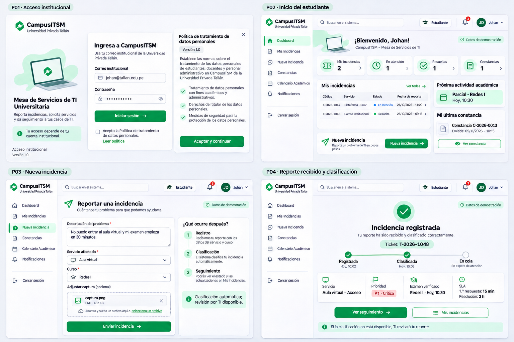
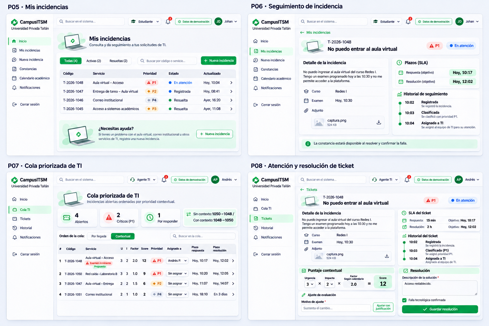

# Plan de implementación de CampusITSM para Johan

Este plan está dirigido exclusivamente a Johan y su agente. Eres responsable del frontend y backend de incidencias y de los componentes visuales compartidos. No eres responsable de todo el frontend ni de un backend separado. Ejecuta solo la semana que Johan indique.

## Estado vigente y punto de partida — 7 de noviembre de 2026

Roberto acordó trabajar con una sola base de desarrollo compartida en Supabase:
cada integrante conserva su frontend/backend en Docker, conectados a esa misma
base cuando se habilite la transición. Leer obligatoriamente
[COORDINACION_SUPABASE.md](../docs/COORDINACION_SUPABASE.md) y
[REGISTRO_CAMBIOS_BD.md](../docs/REGISTRO_CAMBIOS_BD.md).

**Estado comprobado, distinto del destino acordado:**

| Área | Situación |
| --- | --- |
| Main y base visual/calendario | origin/main `02d10f5`, PR #1/#2 integradas; componentes/P17/P18 disponibles |
| Identidad real | Rama `identidad-supabase`, commit `8b02d6f`, todavía sin integrar/publicar en main. Registro, confirmación, login y administrador probados por Roberto; ver entrega de identidad |
| Negocio en Supabase | Traslado y conexión compartida pendientes. El Compose actual todavía usa PostgreSQL local y aplica migraciones al arrancar |
| Colaboradores | Acceso acordado para Johan/Jasmine; invitaciones y alcance de permisos todavía por configurar |
| Correo | SMTP propio para destinatarios externos pendiente; compartir la base no resuelve esa restricción |
| Módulos | Johan conserva P02–P08; Jasmine P09–P12/P15/P20–P23; Roberto sus pantallas e infraestructura común |

La revisión de GitHub para actualizar estos planes encontró `main`, la rama
remota `front-vistas` conservada y la rama local de identidad. Revisar de nuevo
el estado real antes de implementar; esta fotografía no prueba el estado futuro.

**Punto de inicio para tu agente:** leer AGENTS, memoria, este plan,
COORDINACION_SUPABASE, ESTADO_EQUIPO, contratos y DISENO_COMPONENTES. Obtener el
código base autorizado por Roberto; no presentar la rama de identidad como main.
No recrear Docker, catálogos, identidad o componentes por una dependencia pendiente.

Una sola instalación Docker `campusitsm` por computadora, en localhost:8080.
Una rama Git no aísla la base: cuando la conexión común esté habilitada, todas
las escrituras remotas afectarán a los tres. Hasta entonces avanzar en código,
contratos y pruebas aisladas de la semana solicitada. No conectar por cuenta
propia una rama al destino remoto ni aplicar sus migraciones al arrancar.
Las instrucciones de arranque se actualizarán en la entrega de transición;
no ejecutar pruebas destructivas o semillas masivas sobre la base compartida.

## Contexto completo y alcance acordado

CampusITSM es una mesa de ayuda para la Universidad Privada Tallán, institución ficticia del caso académico. Tiene tres casos de uso:

1. **CU01:** usuario registra una incidencia y evidencia; el sistema clasifica, consulta el contexto académico y prioriza; TI atiende y resuelve; el usuario sigue el avance.
2. **CU02:** el titular solicita una constancia después de resolver y confirmar la falla; el sistema genera PDF/QR y permite verificar emisión y archivo.
3. **CU03:** se preparan datos históricos, se evalúa un modelo y se pronostica demanda; se generan alertas; supervisor y administrador preparan recursos y gobiernan el sistema.

El equipo es Roberto, Johan y Jasmine. Cada integrante hace frontend, backend y pruebas de sus módulos. Roberto coordina integración. Hay cuatro semanas relativas al inicio efectivo, sin fechas de calendario fijadas, con 11–20 horas semanales por persona. La cuarta semana se reserva principalmente para integración, pruebas y correcciones.

Este plan y su paquete incluyen el contexto necesario para comenzar sin otra conversación; los documentos compartidos y el código vigente se revisan en cada sesión. Los [casos de uso y catálogo](../diseno/campusitsm/CASOS_DE_USO_Y_PANTALLAS.md) son material complementario; las instrucciones actuales acordadas aquí actualizan las decisiones abiertas de ese catálogo.

**Primera versión acordada:** frontend/backend y Python en Docker de cada integrante, una misma base de negocio PostgreSQL de desarrollo en Supabase y Supabase Auth alojado para una institución/equipo; calendario manual/CSV, PDF verificable y notificaciones internas. La transición compartida todavía debe prepararse y verificarse. Registro propio elegido por Roberto; envío de confirmaciones externas pendiente de SMTP. No se incluyen inicio institucional externo, integración académica real, correo de notificaciones generales, firma digital certificada, reapertura/cierre adicional, multiinstitución ni publicación pública de frontend/backend.

La clasificación por IA y el pronóstico son componentes distintos. El proveedor con opción gratuita de clasificación se elegirá con Roberto cuando llegue ese módulo; no asumir que un proveedor sigue siendo gratuito ni contratarlo unilateralmente. El pronóstico se ejecutará localmente en Python.

### Stack único

| Capa | Decisión |
| --- | --- |
| Frontend | React + Vite + TypeScript; React Router para navegación; TanStack Query para datos del servidor |
| Diseño | Base visual compartida de casos-gestion; DM Sans/Manrope, Phosphor y CSS con tokens; Recharts al implementar gráficos |
| Backend | Una API NestJS modular en TypeScript, prefijo `/api/v1`, contratos OpenAPI |
| Identidad | Supabase Auth alojado y autorización NestJS implementados en rama de Roberto, pendientes de integración en main |
| Persistencia | Una base de desarrollo compartida en Supabase, Prisma y migraciones versionadas; transición pendiente; PostgreSQL aislado para pruebas |
| Predicciones | Python con pandas y statsmodels, expuesto solo al backend mediante servicio interno |
| Tareas | pg-boss sobre PostgreSQL; tareas persistentes sin añadir Redis en esta versión |
| Ejecución | Docker de cada integrante para web/api/predictions; conexión PostgreSQL remota compartida tras transición. db local solo para pruebas; migración remota separada del arranque |
| Actualizaciones | Eventos del servidor para tickets/notificaciones; al reconectar se vuelve a consultar estado actual |
| Pruebas | Pruebas unitarias de dominio, integración con PostgreSQL, recorridos Playwright y comprobación visual |

La infraestructura compartida debe fijar versiones compatibles y archivos de bloqueo, configuración de ejemplo sin secretos, salud y volúmenes para datos, archivos y modelos. Las claves solo se configuran en el servidor. No conectar React directamente a PostgreSQL o Python.

### Base recibida y organización actual

Repositorio: `https://github.com/RobertoC1006/proyecto-gestion.git`.
Obtener main después de la integración de la PR #2 y registrar su commit exacto.
La base Docker anterior es `196a2144aae253ca672eeeaf721c62204516245a` y la base visual es `047d1a2e0fd4f71bb189ff301cacb6e1f21019cf`.

- `apps/web`: React/Vite/TypeScript, React Router, TanStack Query y componentes compartidos.
- `apps/api`: una API modular NestJS con Prisma, OpenAPI y módulo académico.
- `apps/api/prisma`: esquema y migraciones únicos, coordinados por Roberto.
- `services/predictions`: solo salud/esqueleto interno; no hay pronóstico real.
- `diseno/campusitsm`, `planes` y `docs`: referencias y entregas ya publicadas.
- `front-vistas` quedó preservada en la historia; no es una nueva base que integrar.

Las rutas efectivas se comprueban en OpenAPI. Tickets y constancias mantienen
contratos pendientes; identidad tiene código y contrato operativo en la rama
8b02d6f, pendientes de integración en main. El calendario ya implementa
`/academic/me/events` y consultas internas; `/academic/context` no está implementada,
y el cálculo del factor corresponde a semana 2. No duplicar ese servicio.

## Trabajo coordinado sin duplicación

### Responsables y límites

| Responsable | Propiedad principal | Pantallas propias |
| --- | --- | --- |
| Roberto | Base Docker/esquema/contratos; P01, Supabase Auth y autorización común; calendario/configuración, predicción y notificaciones | P01, P13, P14, P16, P17, P18, P19, P24 |
| Johan | Componentes visuales compartidos, tickets, prioridad, seguimiento, atención y clasificación | P02, P03, P04, P05, P06, P07, P08 |
| Jasmine | Administración de usuarios/permisos sobre la identidad común de Roberto; consentimiento, constancias, privacidad, auditoría y reportes | P09, P10, P11, P12, P15, P20, P21, P22, P23 |

La base visual compartida ya existe: reutilizar `ui.tsx`, `AppHeader`, `Sidebar`, `Dialog` y `PriorityBadge`. Johan coordina su evolución, no debe rehacerla. Ampliar los componentes comunes de forma acordada, sin duplicar controles ni módulos.

Las reglas viven en servicios NestJS, no en componentes React. Las vistas solicitan acciones y muestran resultados. Python recibe datos analíticos y no replica la prioridad de los tickets.

### Contratos y archivos compartidos

Ya existen `PROYECTO.md`, `docs/CONTRATOS.md`, `docs/ESTADO_EQUIPO.md`, `docs/DISENO_COMPONENTES.md`, `docs/CONTRATO_CALENDARIO.md` y `docs/CONTRATO_IDENTIDAD.md`. Consultarlos antes de modificar consumidores. El estado del equipo identifica entregas reales, contratos propuestos y dependencias pendientes.

Contratos mínimos que deben acordarse antes de implementar sus consumidores:

| Dominio | Responsable | Capacidades públicas/internas que debe proporcionar |
| --- | --- | --- |
| Identidad/autorización | Roberto | Supabase Auth, login/logout, sesión, usuario actual, rol, permisos, institución/equipo y autorización por objeto |
| Administración y consentimiento | Jasmine | P20/P21, perfiles/estado/equipo, consentimientos y auditoría usando la identidad y políticas de Roberto |
| Contexto académico | Roberto | Cursos/secciones y asociaciones; eventos aplicables al usuario/curso/fecha; factor y motivo; configuración versionada de SLA |
| Tickets | Johan | Crear/listar/consultar con permisos, adjuntos, asignación, clasificación/ajuste, historial, plazos, resolución y confirmación de falla |
| Constancias | Jasmine | Elegibilidad, emisión idempotente, PDF privado, consulta pública mínima y comprobación de archivo |
| Analítica | Roberto | Series observadas, pronósticos, modelos/evaluaciones, unidades, periodo, fuente y capacidad configurada |
| Reportes | Jasmine | Presentación/exportación autorizada usando consultas y resultados analíticos comunes, sin un segundo cálculo de prioridad/pronóstico |
| Notificaciones | Roberto | Publicar avisos por destinatario, listar, marcar leídos, alertas revisables y eventos para actualización |
| Auditoría | Jasmine | Registrar actor, instante, acción, objeto y cambios; lectura/exportación autorizadas, sin edición desde la aplicación |

Los nombres concretos de rutas y DTO se fijan en `docs/CONTRATOS.md` antes de desarrollar pantallas consumidoras. Identificar estados, campos obligatorios, permisos, paginación, errores y ejemplos. Compartir tipos desde OpenAPI, no copiar modelos Prisma al navegador. No tratar un contrato propuesto en otra rama como si ya estuviera integrado.

Cada integrante escribe y valida las migraciones de su módulo en el único esquema Prisma. Una vez habilitados Supabase compartido y sus accesos, puede crear tablas, columnas e índices nuevos de su módulo, compatibles y dentro del plan, sin pedir permiso por cada cambio. Revisar primero lo existente y las ramas, guardar archivo/commit en Git, validar y registrar/avisar qué se aplicó. Solo quien vaya a programar funciones sobre una tabla nueva necesita actualizar su modelo/código y reconstruir la aplicación si corresponde; ver la tabla en el panel o consultar nuevos registros no requiere reconstruir Docker. Consultar previamente cambios en otros módulos, identidad/permisos comunes o incompatibles. No borrar tablas/datos existentes. Puede aplicarse una migración ordinaria delegada antes de fusionar todo el módulo; main sigue bajo revisión de Roberto. Conservar el historial exacto de migraciones y compartir dependencias. Ver COORDINACION_SUPABASE y REGISTRO_CAMBIOS_BD.

### Revisión de ramas antes de trabajar

Hacer esta revisión al iniciar una sesión, al comenzar un módulo, al recibir una entrega y antes de integrar:

1. Revisar `git status --short --branch`; identificar trabajo propio y ajeno sin confirmar. No descartarlo, guardarlo automáticamente ni cambiar de rama con modificaciones que puedan perderse.
2. Actualizar referencias con `git fetch origin --prune` y consultar `git branch -a -vv` y el historial de `origin/main`. Si no hay red, registrar que no se verificó GitHub; no afirmar que se está actualizado.
3. Revisar diferencias de la rama de trabajo frente a `origin/main` y los cambios recientes de ramas activas de los compañeros con `git log`, `git diff` y `git show`, sin modificarlas.
4. Leer `PROYECTO.md`, contratos, estado del equipo y entregas vigentes. Si aún no existen, distinguir la base pendiente de un archivo eliminado por error.
5. Confirmar que la funcionalidad requerida no existe ya ni está siendo implementada por otra persona. Anotar dependencias de contratos no integrados.
6. Actualizar la rama mediante integración normal de `origin/main`, resolver conflictos sin pisar trabajo ajeno y repetir las comprobaciones afectadas.

Leer una rama ajena no autoriza a hacer checkout sobre su trabajo local, fusionarla, copiar servicios todavía no acordados o eliminarla. No utilizar `reset --hard`, borrado forzado o push forzado como limpieza rutinaria.

### Ciclo de ramas por módulo

Crear cada rama desde `main` actualizado; un módulo puede continuar entre semanas. Los nombres no llevan `codex/` ni prefijos similares. Puede haber tres ramas de módulo activas, una por integrante.

Entregar commit y PR a Roberto. Tras verificar e integrar, publicar `main`, comprobar que contiene todo el trabajo del módulo y eliminar únicamente esa rama local y remota. Usar borrado local normal, sin forzarlo. Nunca borrar `main`, una rama de otro integrante o una rama con cambios pendientes.

La limpieza se hace por módulo, no por calendario. Si un módulo sigue abierto, conservar su rama; no borrar trabajo para aparentar una entrega semanal. No iniciar el módulo dependiente hasta que su base esté disponible.

## Reglas comunes del sistema

- Roles: `estudiante`, `docente`, `ti_agente`, `ti_supervisor`, `administrador`. El servidor determina el rol; no se eligen privilegios desde el encabezado.
- Estudiante/docente ven sus casos; agente, tickets del equipo autorizado; supervisor, operación/analítica autorizada; administrador, configuración/gobierno. Público solo consulta mínima de constancias. Comprobar siempre permisos en la API y en descargas.
- Supabase Auth gestionará credenciales. Roberto define una única sesión/autorización de servidor, conservando cookies HttpOnly y protección de escrituras; no duplicar contraseñas. No guardar tokens, credenciales ni datos de negocio en localStorage. Consultar el contrato operativo de rama en `docs/CONTRATO_IDENTIDAD.md` y el estado de su integración.
- Fechas guardadas en UTC, mostradas en `America/Lima`. SLA inicial continuo, sin descontar noches o feriados.
- Estados iniciales: `registrado`, `clasificado`, `en_atencion`, `resuelto`. Mantener estado de clasificación independiente si falta revisión. Confirmación de falla es un dato separado.
- Urgencia e impacto de 1 a 3. Factor: regular: 1; entrega con vencimiento futuro menor a 48 h: 1,5; matrícula en curso: 1,7; examen en curso o menor a 24 h: 2. Usar el máximo aplicable a ese usuario/curso.
- Puntaje = urgencia × impacto × factor. P1 ≥ 9; P2 ≥ 5 y < 9; P3 ≥ 3 y < 5; P4 < 3.
- Respuesta/resolución: P1 15 min/2 h; P2 1 h/4 h; P3 4 h/24 h; P4 8 h/72 h. Primera respuesta es atención humana, no el acuse o la clasificación.
- TI puede ajustar valores con motivo obligatorio y auditoría. Conservar antes/después e historial de plazos; no reiniciar el reloj para aparentar cumplimiento.
- Si falta IA o contexto confiable, conservar el ticket y derivarlo a revisión; no inventar factor, clasificación o prioridad baja.
- Adjuntos PNG/JPG/PDF de hasta 5 MB, validación del archivo, almacenamiento privado y descarga autorizada.
- Constancia del titular: ticket resuelto y falla confirmada. Emisión repetida no crea duplicados. PDF con QR real y huella final registrada; consulta pública con nombre enmascarado. La emisión no aprueba por sí misma una reprogramación.
- Predicción diaria a 14 días, referencia semanal frente a candidato SARIMAX, métricas calculadas y evaluación temporal. No aumentar automáticamente prioridades individuales por una alerta de demanda.
- Datos sintéticos separados/identificados. No atribuir eficacia real, satisfacción, cumplimiento o mejoras a las cifras de las imágenes.
- Auditoría desde las primeras operaciones; no registrar secretos ni contenido privado completo en logs.

La marca de la interfaz es CampusITSM, Universidad Privada Tallán. No confundir la institución ficticia con la universidad del curso.

## Fidelidad visual y reutilización

La estructura, campos y acciones se toman del cuadrante asignado en los mockups
finales. El acabado vigente usa la base visual que Roberto ya adaptó de
`RobertoC1006/casos-gestion`, no la vista provisional de front-vistas.
Esta decisión actualiza la indicación anterior de Lucide/estilos a reproducir
desde cero. Leer `docs/DISENO_COMPONENTES.md` antes de implementar una pantalla.

- Reutilizar `apps/web/src/components/ui.tsx`: Button/ButtonLink, Card/CardHeading,
  Field/Select, Notice, PageHeading, Modal, Breadcrumbs y estados compartidos.
- Mantener DM Sans/Manrope, Phosphor, tokens y estilos de `apps/web/src/app/globals.css`.
  Usar el Sidebar/AppHeader/layout existentes, sin otro menú ni otra cabecera.
- `Dialog` delega en el Modal común. No crear otro diálogo o catálogo de controles.
- Las vistas antiguas están aisladas bajo `.legacy-view`; al registrar rutas nuevas,
  coordinar el layout para que reciban los componentes vigentes, sin estilos de
  compatibilidad provisionales ni una nueva familia de controles.
- Ampliar componentes compartidos solo donde falte una capacidad real, revisar su
  efecto en calendario/acceso y documentar la entrega para los otros módulos.
- No importar localStorage, datos, cuentas, flujos ni reglas de Soluciona TI:
  únicamente se reutilizó su base visual para CampusITSM.

Conservar distribución, jerarquía, verde/menta, superficies y contenido de los
mockups, sustituyendo datos ilustrativos por datos reales. Un gráfico o QR debe
generarse desde su función, no copiarse como imagen. No inventar métricas.

Revisar capturas con viewport 1440 × 900 y adaptación 390 × 844; abrirlas y comparar
legibilidad, distribución, solapamientos, foco y estados. Las capturas con fixtures
deben identificarse como prueba visual y no demuestran un recorrido autenticado.
Cada entrega registra diferencias funcionales/visuales pendientes.

## Pantallas propias y mockups exactos

| Pantalla | Resultado a implementar | Referencia y posición |
| --- | --- | --- |
| P02 Inicio del estudiante | Resumen personal, actividad propia, acceso a reporte y próximo evento correspondiente | Lámina 1, arriba derecha |
| P03 Nueva incidencia | Descripción, servicio, curso, evidencia y envío validado | Lámina 1, abajo izquierda |
| P04 Reporte recibido y clasificación | Identificador, progreso, prioridad y acciones según el estado real | Lámina 1, abajo derecha |
| P05 Mis incidencias | Solo casos propios, búsqueda, filtros, estados y detalle | Lámina 2, arriba izquierda |
| P06 Seguimiento | Datos, evidencia, plazos y línea de tiempo actualizada | Lámina 2, arriba derecha |
| P07 Cola de TI | Tickets autorizados abiertos, prioridad, filtros, orden y asignación | Lámina 2, abajo izquierda |
| P08 Atención y resolución | Contexto, puntaje, ajustes, antecedentes, SLA y resolución | Lámina 2, abajo derecha |

### Lámina 1 — P02, P03 y P04

Archivo final: `01_cu01_ingreso_reporte_v2.png`. P01 pertenece ahora a Roberto; consumir su acceso con Supabase Auth cuando esté integrado.



### Lámina 2 — P05 a P08

Archivo final: `02_cu01_seguimiento_atencion_v2.png`. Implementar las cuatro pantallas.



## Antes de comenzar — Obtener la base compartida publicada

La base Docker ya está publicada y la entrega de componentes/calendario se libera
mediante PR #2. No esperar que Roberto vuelva a crearla ni recuperar front-vistas.

1. Conservar cambios locales y revisar Git. Obtener main después de verificar PR #2.
2. Leer README, estado del equipo, contrato de identidad y guía visual. Confirmar
   `apps/web`, `apps/api`, `services/predictions` y las migraciones existentes.
3. Recibir la configuración y el commit de transición habilitado por Roberto.
   Hasta entonces el Compose existente sigue siendo local: no apuntar sus migraciones
   automáticas a Supabase. Después, reconstruir la misma instalación con la guía vigente.
4. Revisar `ui.tsx`, Sidebar/AppHeader, estilos y P17/P18 como ejemplos de consumo.
5. Identidad/permisos se reciben de Roberto; auditoría/consentimiento, de Jasmine.
   Mientras falten, desarrollar dominio/pruebas/contratos con acceso cerrado.
6. Publicar pronto el contrato de tickets/adjuntos que consumirá Jasmine. Puedes
   crear y validar las tablas nuevas de incidencias dentro del módulo delegado,
   registrarlas y aplicarlas sin permiso por tabla cuando el entorno esté habilitado.
   Coordinar antes solo si alteras partes comunes, otros módulos o compatibilidad.

El paquete de tu plan es documentación y referencias, no otro proyecto que ejecutar.
El código y los contenedores se obtienen del repositorio común.

## Semana 1 — Componentes compartidos y reporte persistente

**Rama inicial:** `gestion-incidencias`, desde main con la base visual integrada.
La familia compartida ya está entregada por Roberto. Usar `componentes-compartidos`
solo si hace falta una ampliación concreta que deba entregarse separadamente antes
de sus consumidores; no reabrir el trabajo de crear toda la base visual.

### Componentes y diseño

- Reutilizar y revisar la base ya publicada en `apps/web/src/components/ui.tsx`,
  AppHeader/Sidebar/Dialog/PriorityBadge y `app/globals.css`; no restaurar Lucide.
- Conservar estructura/acciones de P02–P08 y aplicar el acabado de casos-gestion
  ya adaptado: no diseñar otro tema ni copiar las pantallas del minimarket.
- Registrar rutas nuevas de forma que no hereden `.legacy-view`, reservado para
  vistas provisionales. Separar layout público/autenticado usando el contrato de
  sesión de Roberto, sin otorgar permisos desde el menú.
- Ampliar controles, tablas/badges y estados solo cuando tu módulo lo necesite;
  registrar ejemplos y comprobar que P17/P18 y las páginas de Jasmine no se rompan.
- Recibir la identidad de Roberto y pedir los cambios necesarios en su contrato;
  no construir otra autenticación para desbloquear el portal.

### Ticket y portal

- Implementar creación, consulta autorizada y listado con filtros/paginación en NestJS y PostgreSQL.
- Vincular titular desde la sesión, sin aceptar otro titular arbitrario desde el formulario.
- Guardar descripción, servicio, curso/sección y evidencia opcional. Controlar formato/tamaño y servir adjuntos mediante autorización.
- Evitar tickets duplicados al repetir un envío o reintentar después de una interrupción.
- Conectar P02–P05 con datos del servidor. No mezclar casos de otros usuarios en el dashboard personal.
- P04 distingue registrado, clasificación pendiente y revisión manual. No mostrar éxito de clasificación antes de que ocurra.
- Recibir identidad/permisos de Roberto y contexto académico de Roberto; desarrollar dominio/pruebas con contratos cuando una dependencia aún no esté integrada.

### Resultado y aceptación

- [ ] Crear reporte, recibir código y verlo después en listado/detalle.
- [ ] Errores no borran los campos ya escritos; adjunto inválido se puede corregir.
- [ ] Otro usuario no consulta el caso/adjunto alterando un identificador.
- [ ] Reiniciar no pierde tickets y no crea copias.
- [ ] P02–P05 coinciden visualmente con sus referencias.
- [ ] Se reutiliza la base visual publicada; cualquier ampliación compartida quedó documentada y comprobada con los otros módulos.

**Demostración:** con el acceso de Roberto integrado, Johan crea un reporte, actualiza la página y lo encuentra en su listado.

## Semana 2 — Prioridad, cola y resolución completa

Continuar `gestion-incidencias` si no terminó; no crear otra rama para el mismo trabajo solo porque cambió la semana.

### Backend y seguimiento

- Implementar clasificación manual por TI, asignación, detalle, historial, ajustes y resolución.
- Mantener una única implementación de prioridad. Consumir factor y eventos de Roberto, no inferir eventos reales solo por palabras del reporte.
- Probar T1=12/P1, T2=9/P1, T3=6/P2 y T4=2/P4. El ejemplo del laboratorio no tiene evaluación; corregir la descripción contradictoria del mock original.
- Crear modos llegada (fecha ascendente), técnico (urgencia×impacto) y contextual (puntaje). Para empates, fecha de creación y luego identificador. Comparar técnico frente a contextual para demostrar el cambio T2→T1.
- Excluir resueltos de la cola de abiertos. Pendientes de clasificación/contexto van a revisión visible; no se esconden con P4 inventado.
- Registrar primera atención humana, plazos y resolución. Mantener auditoría y motivo de cambios; no reiniciar reloj para mejorar cifras.
- El ajuste modifica urgencia/impacto con motivo; el factor es calculado por calendario, no editable como escala técnica.
- Actualizar seguimiento mediante eventos autorizados; al reconectar consultar estado real.
- Publicar a Jasmine una consulta autorizada de ticket con titular, servicio, actividad, instantes, estado y falla confirmada. No duplicar la emisión de constancias en tickets.

### Pantallas

P06 muestra información y progreso sin exponer puntaje técnico al estudiante. P07 muestra operaciones y datos del equipo autorizado. P08 permite revisar antecedentes, ajustar, atender, describir solución y confirmar falla de forma explícita. La resolución no siempre implica confirmación de una falla tecnológica.

### Aceptación

- [ ] Puntajes, límites de prioridad y SLA funcionan en casos frontera.
- [ ] Se demuestran tres ordenamientos sin falsear el orden por llegada.
- [ ] Asignación y resolución aparecen en el seguimiento del titular.
- [ ] Ajustes sin motivo se rechazan; cambios simultáneos no sobrescriben silenciosamente una resolución.
- [ ] Identificador de ruta selecciona el ticket correcto; nunca siempre el primer mock.
- [ ] Jasmine puede emitir constancia de un caso elegible usando tu contrato.
- [ ] P06–P08 y datos repetidos entre pantallas son coherentes.

**Demostración conjunta:** reportar→clasificar manualmente→priorizar→atender→resolver→solicitar constancia en el módulo de Jasmine.

## Semana 3 — IA clasificadora real

**Rama:** `clasificacion-ia`, después de integrar incidencias.

### Punto de consulta obligatorio

Solicitar a Roberto la elección del proveedor con opción gratuita y sus condiciones vigentes. No asumir Gemini, Grok u otro, ni contratar servicios. Si falta la decisión, avanzar con pruebas del contrato y revisión manual de la misma semana, sin presentar una simulación como integración real.

### Implementación

- Crear adaptador intercambiable que reciba texto necesario y devuelva categoría válida, urgencia 1–3, impacto 1–3 y explicación.
- Validar categorías y escala en NestJS; no permitir que el proveedor cambie usuario, permisos, plazos o resolución.
- Guardar el reporte antes de clasificar; gestionar cuota, red, formato inválido y límite de espera de 3 segundos con derivación manual.
- No enviar identificadores personales o adjuntos por defecto. Configurar clave solo en servidor y no registrarla en logs.
- Registrar proveedor/modelo, versión del adaptador y resultado útil para evaluación.
- Usar versión/estado de revisión del ticket para descartar respuestas tardías que sobrescribirían una corrección de TI.
- Conectar estados y mensajes reales a P04/P07/P08. No garantizar tres segundos de éxito de un servicio externo; garantizar la salida a revisión cuando exceda el presupuesto.

### Aceptación

- [ ] Clasificación real con clave configurada y proveedor elegido.
- [ ] Sin clave, cuota o proveedor, el ticket sigue existiendo y TI puede atenderlo.
- [ ] Respuesta fuera de escala se rechaza; respuesta tardía no pisa ajuste humano.
- [ ] Ninguna credencial aparece en frontend o logs.
- [ ] Evaluación con reportes etiquetados independientes de los ejemplos del prompt, mostrando precisión medida, no la meta 85 % como hecho.
- [ ] Los estados de proceso/error conservan el diseño de las pantallas.

## Semana 4 — Correcciones y entrega de incidencias

**Rama:** `correcciones-incidencias`, después de integrar la anterior.

1. Ejecutar CU01 completo con varios usuarios y con clasificación real/manual.
2. Probar cortes y reconexiones, reintentos de envío, rutas desconocidas, filtros vacíos y archivos inválidos.
3. Revisar formularios, foco visible, etiquetas, teclado, contraste y mensajes de error.
4. Comparar capturas de las siete pantallas a 1440 × 900 y adaptación a 390 × 844. Mantener estructura visual; no rediseñar en esta etapa.
5. Verificar que una corrección de componente no rompa calendarios, constancias o administración de compañeros.
6. Aportar resultados de pruebas de prioridad/SLA, precisión clasificadora y guion de demostración; no presentar una reducción de alertas o un valor de mockup como mejora experimental.

**Cierre:** CU01 completo, componentes compartidos estables, datos y permisos reales y dependencias entregadas a Jasmine/Roberto. No desarrollar reportes, notificaciones o PDF alternativos para compensar una conexión pendiente.

## Entrega semanal y regla de parada

Al terminar la semana solicitada, entregar un resumen y registrar `docs/entregas/<persona>-semana-0N.md`. El archivo debe distinguir terminado, pendiente y bloqueado; no incluir claves ni datos personales reales.

```text
Responsable:
Semana y módulo:
Rama:
Commit y PR:
Commit de origin/main utilizado:
Ramas de compañeros revisadas y dependencias detectadas:
Pantallas y acciones funcionales:
Contratos/esquema modificados y coordinación realizada:
Base de destino y estado de habilitación compartida:
Migraciones anunciadas/aplicadas, commit, alcance delegado o acuerdo común, ejecutor y verificación:
Cambios/dependencias comunicados a los otros módulos:
Pruebas ejecutadas y resultado:
Capturas comparadas con cada mockup:
Cómo reproducir la demostración:
Problemas conocidos y solicitudes a compañeros:
Condiciones necesarias para la siguiente semana:
```

No marcar un módulo terminado porque se ve bien si aún usa respuestas ficticias. No marcarlo fiel al diseño porque funciona si su apariencia difiere de los mockups.

**Detenerse después de entregar el avance.** No iniciar automáticamente la siguiente semana ni resolver módulos de otro integrante para eludir una dependencia. Si el integrante no indicó semana, empezar por revisar precondiciones y Semana 1. Puede continuarse con pruebas, documentación o tareas independientes de esa misma semana mientras se solicita un contrato pendiente.

La cuarta semana debe terminar con los tres casos integrados y las 24 pantallas funcionales. La disponibilidad 99,5 %, los 500 usuarios simultáneos y las metas académicas se evalúan y se reportan; no se afirman por instalar Docker ni se presentan como alcanzadas si las mediciones no lo respaldan.
