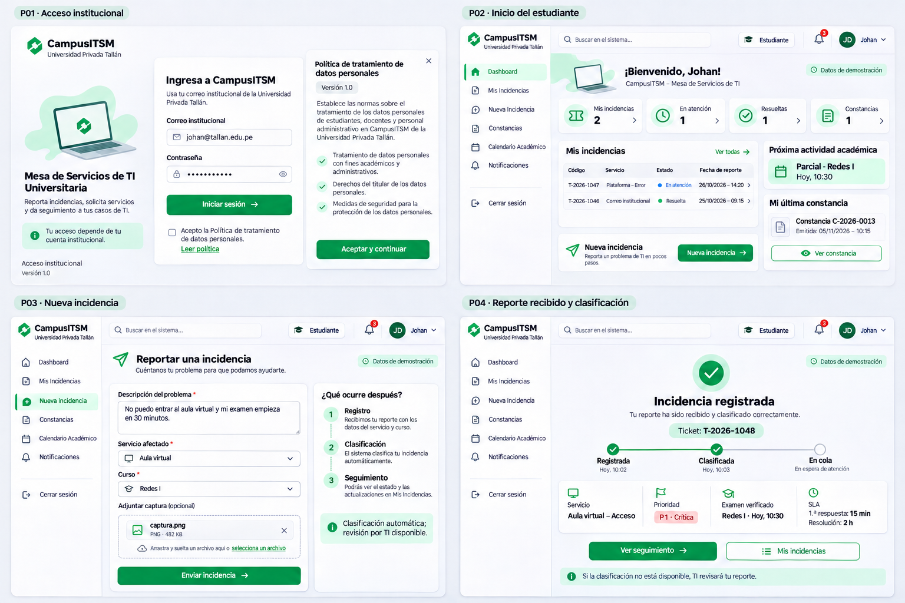
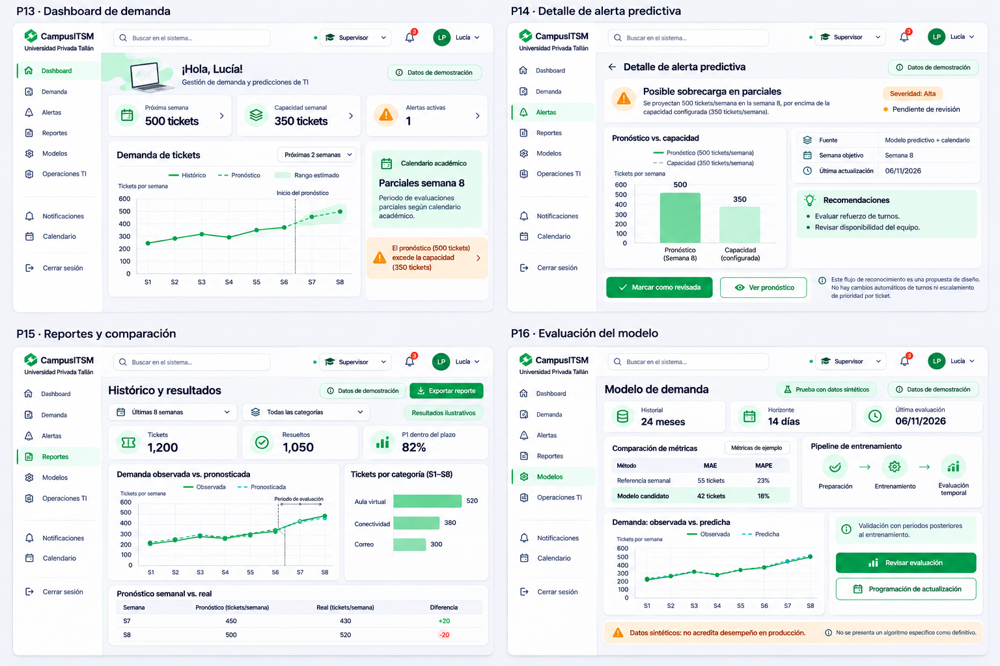
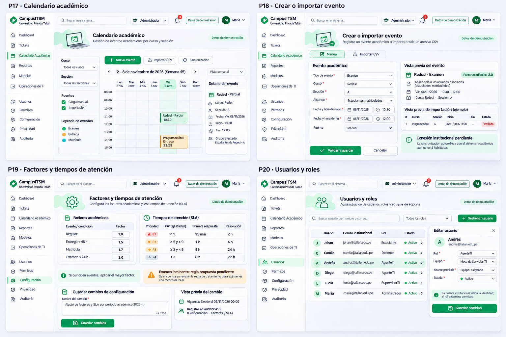
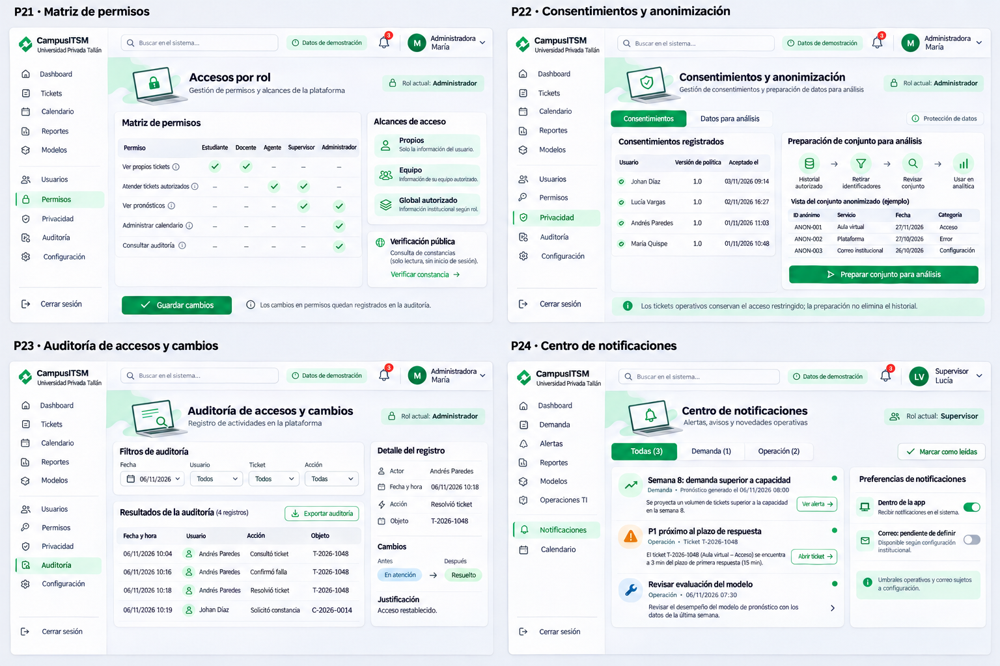

# Plan de implementación de CampusITSM para Roberto

Este plan está dirigido exclusivamente a Roberto y su agente. Tu base Docker y el calendario manual ya tienen entregas verificadas. Identidad tiene una entrega en rama; el siguiente avance de infraestructura acordado es preparar la base de desarrollo compartida en Supabase, su conexión y la coordinación de colaboradores. Ejecuta solo la etapa solicitada y no implementes las cuatro semanas de golpe.

## Estado vigente y punto de partida — 7 de noviembre de 2026

Roberto acordó trabajar con una sola base de desarrollo compartida en Supabase:
cada integrante conserva su frontend/backend en Docker, conectados a esa misma
base cuando se habilite la transición. Leer obligatoriamente
[COORDINACION_SUPABASE.md](../docs/COORDINACION_SUPABASE.md) y
[REGISTRO_CAMBIOS_BD.md](../docs/REGISTRO_CAMBIOS_BD.md).

**Estado comprobado, distinto del destino acordado:**

| Área | Situación |
| --- | --- |
| Main y base visual/calendario | origin/main `02d10f5`, PR #1/#2 integradas; componentes/P17/P18 disponibles |
| Identidad real | Rama `identidad-supabase`, commit `8b02d6f`, todavía sin integrar/publicar en main. Registro, confirmación, login y administrador probados por Roberto; ver entrega de identidad |
| Negocio en Supabase | Traslado y conexión compartida pendientes. El Compose actual todavía usa PostgreSQL local y aplica migraciones al arrancar |
| Colaboradores | Acceso acordado para Johan/Jasmine; invitaciones y alcance de permisos todavía por configurar |
| Correo | SMTP propio para destinatarios externos pendiente; compartir la base no resuelve esa restricción |
| Módulos | Johan conserva P02–P08; Jasmine P09–P12/P15/P20–P23; Roberto sus pantallas e infraestructura común |

La revisión de GitHub para actualizar estos planes encontró `main`, la rama
remota `front-vistas` conservada y la rama local de identidad. Revisar de nuevo
el estado real antes de implementar; esta fotografía no prueba el estado futuro.

**Punto de inicio para tu agente:** leer AGENTS, memoria, este plan,
COORDINACION_SUPABASE, ESTADO_EQUIPO, contratos y DISENO_COMPONENTES. Obtener el
código base autorizado por Roberto; no presentar la rama de identidad como main.
No recrear Docker, catálogos, identidad o componentes por una dependencia pendiente.

Una sola instalación Docker `campusitsm` por computadora, en localhost:8080.
Una rama Git no aísla la base: cuando la conexión común esté habilitada, todas
las escrituras remotas afectarán a los tres. Hasta entonces avanzar en código,
contratos y pruebas aisladas de la semana solicitada. No conectar por cuenta
propia una rama al destino remoto ni aplicar sus migraciones al arrancar.
Las instrucciones de arranque se actualizarán en la entrega de transición;
no ejecutar pruebas destructivas o semillas masivas sobre la base compartida.

## Contexto completo y alcance acordado

CampusITSM es una mesa de ayuda para la Universidad Privada Tallán, institución ficticia del caso académico. Tiene tres casos de uso:

1. **CU01:** usuario registra una incidencia y evidencia; el sistema clasifica, consulta el contexto académico y prioriza; TI atiende y resuelve; el usuario sigue el avance.
2. **CU02:** el titular solicita una constancia después de resolver y confirmar la falla; el sistema genera PDF/QR y permite verificar emisión y archivo.
3. **CU03:** se preparan datos históricos, se evalúa un modelo y se pronostica demanda; se generan alertas; supervisor y administrador preparan recursos y gobiernan el sistema.

El equipo es Roberto, Johan y Jasmine. Cada integrante hace frontend, backend y pruebas de sus módulos. Roberto coordina integración. Hay cuatro semanas relativas al inicio efectivo, sin fechas de calendario fijadas, con 11–20 horas semanales por persona. La cuarta semana se reserva principalmente para integración, pruebas y correcciones.

Este plan y su paquete incluyen el contexto necesario para comenzar sin otra conversación; los documentos compartidos y el código vigente se revisan en cada sesión. Los [casos de uso y catálogo](../diseno/campusitsm/CASOS_DE_USO_Y_PANTALLAS.md) son material complementario; las instrucciones actuales acordadas aquí actualizan las decisiones abiertas de ese catálogo.

**Primera versión acordada:** frontend/backend y Python en Docker de cada integrante, una misma base de negocio PostgreSQL de desarrollo en Supabase y Supabase Auth alojado para una institución/equipo; calendario manual/CSV, PDF verificable y notificaciones internas. La transición compartida todavía debe prepararse y verificarse. Registro propio elegido por Roberto; envío de confirmaciones externas pendiente de SMTP. No se incluyen inicio institucional externo, integración académica real, correo de notificaciones generales, firma digital certificada, reapertura/cierre adicional, multiinstitución ni publicación pública de frontend/backend.

La clasificación por IA y el pronóstico son componentes distintos. El proveedor con opción gratuita de clasificación se elegirá con Roberto cuando llegue ese módulo; no asumir que un proveedor sigue siendo gratuito ni contratarlo unilateralmente. El pronóstico se ejecutará localmente en Python.

### Stack único

| Capa | Decisión |
| --- | --- |
| Frontend | React + Vite + TypeScript; React Router para navegación; TanStack Query para datos del servidor |
| Diseño | Base visual compartida de casos-gestion; DM Sans/Manrope, Phosphor y CSS con tokens; Recharts al implementar gráficos |
| Backend | Una API NestJS modular en TypeScript, prefijo `/api/v1`, contratos OpenAPI |
| Identidad | Supabase Auth alojado y autorización NestJS implementados en rama de Roberto, pendientes de integración en main |
| Persistencia | Una base de desarrollo compartida en Supabase, Prisma y migraciones versionadas; transición pendiente; PostgreSQL aislado para pruebas |
| Predicciones | Python con pandas y statsmodels, expuesto solo al backend mediante servicio interno |
| Tareas | pg-boss sobre PostgreSQL; tareas persistentes sin añadir Redis en esta versión |
| Ejecución | Docker de cada integrante para web/api/predictions; conexión PostgreSQL remota compartida tras transición. db local solo para pruebas; migración remota separada del arranque |
| Actualizaciones | Eventos del servidor para tickets/notificaciones; al reconectar se vuelve a consultar estado actual |
| Pruebas | Pruebas unitarias de dominio, integración con PostgreSQL, recorridos Playwright y comprobación visual |

La infraestructura compartida debe fijar versiones compatibles y archivos de bloqueo, configuración de ejemplo sin secretos, salud y volúmenes para datos, archivos y modelos. Las claves solo se configuran en el servidor. No conectar React directamente a PostgreSQL o Python.

### Base recibida y organización actual

Repositorio: `https://github.com/RobertoC1006/proyecto-gestion.git`.
Obtener main después de la integración de la PR #2 y registrar su commit exacto.
La base Docker anterior es `196a2144aae253ca672eeeaf721c62204516245a` y la base visual es `047d1a2e0fd4f71bb189ff301cacb6e1f21019cf`.

- `apps/web`: React/Vite/TypeScript, React Router, TanStack Query y componentes compartidos.
- `apps/api`: una API modular NestJS con Prisma, OpenAPI y módulo académico.
- `apps/api/prisma`: esquema y migraciones únicos, coordinados por Roberto.
- `services/predictions`: solo salud/esqueleto interno; no hay pronóstico real.
- `diseno/campusitsm`, `planes` y `docs`: referencias y entregas ya publicadas.
- `front-vistas` quedó preservada en la historia; no es una nueva base que integrar.

Las rutas efectivas se comprueban en OpenAPI. Tickets y constancias mantienen
contratos pendientes; identidad tiene código y contrato operativo en la rama
8b02d6f, pendientes de integración en main. El calendario ya implementa
`/academic/me/events` y consultas internas; `/academic/context` no está implementada,
y el cálculo del factor corresponde a semana 2. No duplicar ese servicio.

## Trabajo coordinado sin duplicación

### Responsables y límites

| Responsable | Propiedad principal | Pantallas propias |
| --- | --- | --- |
| Roberto | Base Docker/esquema/contratos; P01, Supabase Auth y autorización común; calendario/configuración, predicción y notificaciones | P01, P13, P14, P16, P17, P18, P19, P24 |
| Johan | Componentes visuales compartidos, tickets, prioridad, seguimiento, atención y clasificación | P02, P03, P04, P05, P06, P07, P08 |
| Jasmine | Administración de usuarios/permisos sobre la identidad común de Roberto; consentimiento, constancias, privacidad, auditoría y reportes | P09, P10, P11, P12, P15, P20, P21, P22, P23 |

La base visual compartida ya existe: reutilizar `ui.tsx`, `AppHeader`, `Sidebar`, `Dialog` y `PriorityBadge`. Johan coordina su evolución, no debe rehacerla. Ampliar los componentes comunes de forma acordada, sin duplicar controles ni módulos.

Las reglas viven en servicios NestJS, no en componentes React. Las vistas solicitan acciones y muestran resultados. Python recibe datos analíticos y no replica la prioridad de los tickets.

### Contratos y archivos compartidos

Ya existen `PROYECTO.md`, `docs/CONTRATOS.md`, `docs/ESTADO_EQUIPO.md`, `docs/DISENO_COMPONENTES.md`, `docs/CONTRATO_CALENDARIO.md` y `docs/CONTRATO_IDENTIDAD.md`. Consultarlos antes de modificar consumidores. El estado del equipo identifica entregas reales, contratos propuestos y dependencias pendientes.

Contratos mínimos que deben acordarse antes de implementar sus consumidores:

| Dominio | Responsable | Capacidades públicas/internas que debe proporcionar |
| --- | --- | --- |
| Identidad/autorización | Roberto | Supabase Auth, login/logout, sesión, usuario actual, rol, permisos, institución/equipo y autorización por objeto |
| Administración y consentimiento | Jasmine | P20/P21, perfiles/estado/equipo, consentimientos y auditoría usando la identidad y políticas de Roberto |
| Contexto académico | Roberto | Cursos/secciones y asociaciones; eventos aplicables al usuario/curso/fecha; factor y motivo; configuración versionada de SLA |
| Tickets | Johan | Crear/listar/consultar con permisos, adjuntos, asignación, clasificación/ajuste, historial, plazos, resolución y confirmación de falla |
| Constancias | Jasmine | Elegibilidad, emisión idempotente, PDF privado, consulta pública mínima y comprobación de archivo |
| Analítica | Roberto | Series observadas, pronósticos, modelos/evaluaciones, unidades, periodo, fuente y capacidad configurada |
| Reportes | Jasmine | Presentación/exportación autorizada usando consultas y resultados analíticos comunes, sin un segundo cálculo de prioridad/pronóstico |
| Notificaciones | Roberto | Publicar avisos por destinatario, listar, marcar leídos, alertas revisables y eventos para actualización |
| Auditoría | Jasmine | Registrar actor, instante, acción, objeto y cambios; lectura/exportación autorizadas, sin edición desde la aplicación |

Los nombres concretos de rutas y DTO se fijan en `docs/CONTRATOS.md` antes de desarrollar pantallas consumidoras. Identificar estados, campos obligatorios, permisos, paginación, errores y ejemplos. Compartir tipos desde OpenAPI, no copiar modelos Prisma al navegador. No tratar un contrato propuesto en otra rama como si ya estuviera integrado.

Cada integrante escribe las migraciones de su módulo en el único esquema Prisma. Roberto coordina archivos globales, identidad, relaciones comunes y el orden de aplicación; Johan conserva componentes/incidencias y Jasmine administración/consentimiento/auditoría. Revisar esquema, ramas y cambios anunciados antes de duplicar una tabla o servicio. Una migración pequeña puede aplicarse al desarrollo compartido antes de fusionar el módulo completo, con archivo/commit, validación y autorización concreta de Roberto ya registradas. Roberto o el integrante autorizado la aplica una sola vez y avisa al equipo; una aprobación existente no se pide de nuevo. Conservar en Git el historial exacto, actualizar contratos y no editar migraciones ya aplicadas. Ver COORDINACION_SUPABASE y REGISTRO_CAMBIOS_BD.

### Revisión de ramas antes de trabajar

Hacer esta revisión al iniciar una sesión, al comenzar un módulo, al recibir una entrega y antes de integrar:

1. Revisar `git status --short --branch`; identificar trabajo propio y ajeno sin confirmar. No descartarlo, guardarlo automáticamente ni cambiar de rama con modificaciones que puedan perderse.
2. Actualizar referencias con `git fetch origin --prune` y consultar `git branch -a -vv` y el historial de `origin/main`. Si no hay red, registrar que no se verificó GitHub; no afirmar que se está actualizado.
3. Revisar diferencias de la rama de trabajo frente a `origin/main` y los cambios recientes de ramas activas de los compañeros con `git log`, `git diff` y `git show`, sin modificarlas.
4. Leer `PROYECTO.md`, contratos, estado del equipo y entregas vigentes. Si aún no existen, distinguir la base pendiente de un archivo eliminado por error.
5. Confirmar que la funcionalidad requerida no existe ya ni está siendo implementada por otra persona. Anotar dependencias de contratos no integrados.
6. Actualizar la rama mediante integración normal de `origin/main`, resolver conflictos sin pisar trabajo ajeno y repetir las comprobaciones afectadas.

Leer una rama ajena no autoriza a hacer checkout sobre su trabajo local, fusionarla, copiar servicios todavía no acordados o eliminarla. No utilizar `reset --hard`, borrado forzado o push forzado como limpieza rutinaria.

### Ciclo de ramas por módulo

Crear cada rama desde `main` actualizado; un módulo puede continuar entre semanas. Los nombres no llevan `codex/` ni prefijos similares. Puede haber tres ramas de módulo activas, una por integrante.

Entregar commit y PR a Roberto. Tras verificar e integrar, publicar `main`, comprobar que contiene todo el trabajo del módulo y eliminar únicamente esa rama local y remota. Usar borrado local normal, sin forzarlo. Nunca borrar `main`, una rama de otro integrante o una rama con cambios pendientes.

La limpieza se hace por módulo, no por calendario. Si un módulo sigue abierto, conservar su rama; no borrar trabajo para aparentar una entrega semanal. No iniciar el módulo dependiente hasta que su base esté disponible.

## Reglas comunes del sistema

- Roles: `estudiante`, `docente`, `ti_agente`, `ti_supervisor`, `administrador`. El servidor determina el rol; no se eligen privilegios desde el encabezado.
- Estudiante/docente ven sus casos; agente, tickets del equipo autorizado; supervisor, operación/analítica autorizada; administrador, configuración/gobierno. Público solo consulta mínima de constancias. Comprobar siempre permisos en la API y en descargas.
- Supabase Auth gestionará credenciales. Roberto define una única sesión/autorización de servidor, conservando cookies HttpOnly y protección de escrituras; no duplicar contraseñas. No guardar tokens, credenciales ni datos de negocio en localStorage. Consultar el contrato operativo de rama en `docs/CONTRATO_IDENTIDAD.md` y el estado de su integración.
- Fechas guardadas en UTC, mostradas en `America/Lima`. SLA inicial continuo, sin descontar noches o feriados.
- Estados iniciales: `registrado`, `clasificado`, `en_atencion`, `resuelto`. Mantener estado de clasificación independiente si falta revisión. Confirmación de falla es un dato separado.
- Urgencia e impacto de 1 a 3. Factor: regular: 1; entrega con vencimiento futuro menor a 48 h: 1,5; matrícula en curso: 1,7; examen en curso o menor a 24 h: 2. Usar el máximo aplicable a ese usuario/curso.
- Puntaje = urgencia × impacto × factor. P1 ≥ 9; P2 ≥ 5 y < 9; P3 ≥ 3 y < 5; P4 < 3.
- Respuesta/resolución: P1 15 min/2 h; P2 1 h/4 h; P3 4 h/24 h; P4 8 h/72 h. Primera respuesta es atención humana, no el acuse o la clasificación.
- TI puede ajustar valores con motivo obligatorio y auditoría. Conservar antes/después e historial de plazos; no reiniciar el reloj para aparentar cumplimiento.
- Si falta IA o contexto confiable, conservar el ticket y derivarlo a revisión; no inventar factor, clasificación o prioridad baja.
- Adjuntos PNG/JPG/PDF de hasta 5 MB, validación del archivo, almacenamiento privado y descarga autorizada.
- Constancia del titular: ticket resuelto y falla confirmada. Emisión repetida no crea duplicados. PDF con QR real y huella final registrada; consulta pública con nombre enmascarado. La emisión no aprueba por sí misma una reprogramación.
- Predicción diaria a 14 días, referencia semanal frente a candidato SARIMAX, métricas calculadas y evaluación temporal. No aumentar automáticamente prioridades individuales por una alerta de demanda.
- Datos sintéticos separados/identificados. No atribuir eficacia real, satisfacción, cumplimiento o mejoras a las cifras de las imágenes.
- Auditoría desde las primeras operaciones; no registrar secretos ni contenido privado completo en logs.

La marca de la interfaz es CampusITSM, Universidad Privada Tallán. No confundir la institución ficticia con la universidad del curso.

## Fidelidad visual y reutilización

La estructura, campos y acciones se toman del cuadrante asignado en los mockups
finales. El acabado vigente usa la base visual que Roberto ya adaptó de
`RobertoC1006/casos-gestion`, no la vista provisional de front-vistas.
Esta decisión actualiza la indicación anterior de Lucide/estilos a reproducir
desde cero. Leer `docs/DISENO_COMPONENTES.md` antes de implementar una pantalla.

- Reutilizar `apps/web/src/components/ui.tsx`: Button/ButtonLink, Card/CardHeading,
  Field/Select, Notice, PageHeading, Modal, Breadcrumbs y estados compartidos.
- Mantener DM Sans/Manrope, Phosphor, tokens y estilos de `apps/web/src/app/globals.css`.
  Usar el Sidebar/AppHeader/layout existentes, sin otro menú ni otra cabecera.
- `Dialog` delega en el Modal común. No crear otro diálogo o catálogo de controles.
- Las vistas antiguas están aisladas bajo `.legacy-view`; al registrar rutas nuevas,
  coordinar el layout para que reciban los componentes vigentes, sin estilos de
  compatibilidad provisionales ni una nueva familia de controles.
- Ampliar componentes compartidos solo donde falte una capacidad real, revisar su
  efecto en calendario/acceso y documentar la entrega para los otros módulos.
- No importar localStorage, datos, cuentas, flujos ni reglas de Soluciona TI:
  únicamente se reutilizó su base visual para CampusITSM.

Conservar distribución, jerarquía, verde/menta, superficies y contenido de los
mockups, sustituyendo datos ilustrativos por datos reales. Un gráfico o QR debe
generarse desde su función, no copiarse como imagen. No inventar métricas.

Revisar capturas con viewport 1440 × 900 y adaptación 390 × 844; abrirlas y comparar
legibilidad, distribución, solapamientos, foco y estados. Las capturas con fixtures
deben identificarse como prueba visual y no demuestran un recorrido autenticado.
Cada entrega registra diferencias funcionales/visuales pendientes.

## Pantallas propias y mockups exactos

| Pantalla | Resultado a implementar | Referencia y posición |
| --- | --- | --- |
| P01 Login con Supabase Auth | Acceso, sesión y mensajes reales; consumir el consentimiento de Jasmine | Lámina 1, arriba izquierda |
| P13 Dashboard de demanda | Histórico, pronóstico, rango cuando esté disponible, capacidad y alertas con fuente/periodo | Lámina 4, arriba izquierda |
| P14 Detalle de alerta predictiva | Demanda frente a capacidad, causa, recomendaciones y revisión humana | Lámina 4, arriba derecha |
| P16 Evaluación del modelo | Modelos, ventana de datos, comparación, métricas y estado de evaluación | Lámina 4, abajo derecha |
| P17 Calendario académico | Semana, filtros, eventos y detalle con alcance correcto | Lámina 5, arriba izquierda |
| P18 Crear o importar evento | Formulario, CSV, vista previa, validación y guardado | Lámina 5, arriba derecha |
| P19 Factores y SLA | Configuración validada, motivo de cambio, versión e historial | Lámina 5, abajo izquierda |
| P24 Centro de notificaciones | Listado autorizado, filtros, lectura y acceso al objeto del aviso | Lámina 6, abajo derecha |

### Lámina 1 — P01, ahora a cargo de Roberto

Archivo final: `01_cu01_ingreso_reporte_v2.png`, arriba izquierda. P02–P04 son de Johan.
Usar la base visual compartida, sin selector que conceda privilegios ni login ficticio.



### Lámina 4 — P13, P14 y P16

Archivo final: `04_cu03_predicciones_alertas.png`. P15 pertenece a Jasmine; no implementarlo como una segunda página propia.



### Lámina 5 — P17, P18 y P19

Archivo final: `05_cu03_calendario_configuracion.png`. P20 pertenece a Jasmine.



### Lámina 6 — P24

Archivo final: `06_cu03_permisos_privacidad_auditoria_v2.png`. P21, P22 y P23 pertenecen a Jasmine.



## Entrega previa — Docker ya entregado (registro de aceptación)

Esta entrega ya se completó en PR #1. La lista siguiente conserva lo verificado;
no autoriza a recrear el proyecto. El siguiente punto pendiente está en semana 1,
identidad con Supabase y conexión real del calendario.

Esta entrega ocurre al principio de Semana 1 y desbloquea el trabajo conectado. No esperar a terminar calendario o predicciones para publicarla.

1. Revisar el estado real de Git y recuperar el contenido de `front-vistas` sin perder diseños o cambios locales. No iniciar de nuevo el proyecto ignorando las vistas existentes.
2. Preparar una organización compartida: `apps/web`, `apps/api`, `services/predictions`, manteniendo `diseno/` y `planes/`. Publicar rutas definitivas en el contexto para que nadie cree otras.
3. Mantener React/Vite y crear el esqueleto modular de NestJS y el servicio Python interno. El esqueleto no equivale a implementar los módulos de Johan/Jasmine.
4. Preparar Docker Compose, Dockerfiles, versiones compatibles fijadas, configuración de ejemplo y volúmenes. El frontend es el punto de entrada; API y Python se comunican por red interna. Proporcionar perfil de desarrollo y construcción de entrega.
5. Añadir PostgreSQL, migraciones iniciales, restricciones básicas y semilla reproducible sin credenciales reales. Los datos de demostración no deben reiniciarse en cada arranque ni sobrescribir una base con trabajo.
6. Preparar salud del frontend/API/base/Python y tarea explícita de migración antes de abrir la API. El comando documentado de arranque es `docker compose up --build`.
7. Coordinar el modelo de identidad con Jasmine y el de tickets con Johan. Publicar primero los contratos y entidades necesarios; no imponerles servicios incompletos ocultos tras datos de ejemplo.
8. Actualizar `PROYECTO.md` al stack/equipo actual y crear contratos y estado del equipo. Publicar los mockups finales: no asumir que existen en GitHub porque están en tu carpeta.
9. Verificar construcción desde un clon/copia limpia del repositorio compartido, salud y persistencia tras apagar y volver a levantar sin borrar volúmenes.
10. Integrar/publicar en `main`, registrar el commit exacto y avisar al equipo por el canal que ustedes utilicen. El agente no envía mensajes externos por su cuenta.

**Condición de entrega:** Johan y Jasmine pueden obtener ese commit, configurar su entorno local y construir los mismos contenedores en su Docker. Sus bases y archivos son locales e independientes; no se conectan a tu computadora. Publicar instrucciones de acceso desde otro dispositivo solo si se va a demostrar QR por red local.

La rama fuente `front-vistas` solo se retira después de preservar e integrar todo su contenido y confirmar que no pertenece a trabajo activo de un compañero. Eliminar ramas de módulos creadas por el equipo no autoriza a eliminar trabajo desconocido.

## Siguiente entrega de Roberto — Habilitar la base compartida

El acuerdo ya está documentado; no se trasladó negocio ni se invitó a los compañeros
por editar planes. Preparar esta entrega solo cuando Roberto solicite implementarla.

1. Publicar/coordinar el código base de identidad aprobado, sin fusionarlo en main
   ni borrar ramas hasta contar con autorización de integración.
2. Seguir el inventario, respaldo, traslado conservando UUID, configuración de
   servidor y comprobación entre dos instalaciones descritos en COORDINACION_SUPABASE.
3. Separar arranque de Docker y migración remota; no borrar los volúmenes existentes
   para sustituirlos por Supabase. Conservar Prisma y un solo historial de migraciones.
4. Revisar alcance de colaboradores y secretos, sesiones cifradas, almacenamiento
   de archivos y tareas antes de anunciar qué recursos están realmente compartidos.
5. Actualizar ESTADO_EQUIPO con commit/configuración disponible y resultado real;
   entregar acceso privado y procedimiento a Johan/Jasmine. No incluir secretos en ZIP.
6. Resolver el correo de registro externo con Roberto y recibir los contratos de
   consentimiento/auditoría de Jasmine; no construir sus módulos como sustitución.

Esta infraestructura prepara la semana vigente; no inicia CSV, IA o predicción.

## Semana 1 — Base entregada, Supabase Auth y conexión del calendario

**Entregas anteriores:** `base-proyecto` (PR #1) y `calendario-academico` (PR #2,
integración autorizada por Roberto). No repetir infraestructura ni diseño.
**Entrega actual de identidad:** `identidad-supabase`, commit `8b02d6f`, sin integrar
en main. El siguiente avance de infraestructura es la transición compartida descrita
arriba, pendiente de solicitud de implementación; no volver a iniciar el login.

### Punto de reanudación

1. Conservar Supabase Auth alojado ya configurado, registro propio y recuperación
   por enlace. La base de negocio compartida ahora está acordada, pero su traslado
   no está ejecutado. Seguir la entrega de transición anterior sin recrear Auth.
2. Conservar y verificar el contrato ya implementado de `docs/CONTRATO_IDENTIDAD.md`:
   proveedor Auth, P01, login/logout, sesión/renovación y usuario actual. Credenciales
   en Supabase y tokens cifrados en servidor; adaptar su alcance al compartir la base.
3. Reutilizar los cinco roles, permisos, institución/equipo y autorización común
   por objeto de NestJS. No confundir el role técnico de Supabase con el de CampusITSM.
4. Publicar contratos operativos temprano para Johan/Jasmine, con DTO/OpenAPI y
   pruebas de permisos. No dejarles otra autenticación como dependencia informal.
5. Verificar los adaptadores AcademicIdentity/AcademicDirectory ya conectados al
   usuario canónico durante la transición; revisar
   asociaciones y rechazar cambios de institución/rol/estado que dejen accesos antiguos.
6. Integrar consentimiento y auditoría de Jasmine, conservando AcademicChange y la
   atomicidad. Conectar el calendario personal y demostrar aislamiento por sección.

### Calendario ya implementado: conservar y conectar

- Cursos, secciones, asociaciones, CRUD de eventos, validaciones y versiones ya
  existen en el módulo académico. No duplicar sus tablas, endpoints ni catálogos.
- P17/P18 ya consumen las API y componentes compartidos; en la entrega actual están
  cerradas sin identidad. Las pruebas reales de dominio y las pruebas visuales
  tienen evidencia separada, sin afirmar login funcional.
- Mostrar los eventos aplicables al titular/curso desde el servicio existente.
  El cálculo del factor/SLA y el CSV corresponden a semana 2.

### Aceptación de la semana

- [x] Base Docker entregada y verificada para instalaciones locales independientes.
- [x] Dominio académico, restricciones de fechas/alcance, control de ediciones y registro de cambios probados en PostgreSQL.
- [x] P17/P18 adaptadas a la base visual aprobada de casos-gestion, con capturas de escritorio/móvil.
- [x] P01 autentica con Supabase real configurado; Roberto completó registro/confirmación/login.
- [x] Sesión válida/vencida, logout/renovación y protección de escrituras verificados automáticamente.
- [x] Roles/permisos y cambios de rol/estado verificados en servidor; falta repetir la demostración conjunta tras compartir la base.
- [ ] Calendario se puede administrar con una sesión real; usuario de otra sección no recibe su contexto.
- [ ] Consentimiento/auditoría quedan conectados con Jasmine y los contratos se entregan a Johan.

Priorizar esta base de acceso antes de CSV, predicción o semanas siguientes. El
nuevo reparto aumenta el trabajo de Roberto: revisar la carga de semana 1 con
el equipo; no afirmar que el calendario autenticado o la semana ya están completos.

## Semana 2 — CSV, configuración y preparación analítica

### Trabajo

- Completar P18 con CSV: formato documentado, vista previa, errores por fila, detección de duplicados y confirmación. Validar todo antes de publicar; una importación inválida no modifica datos parcialmente.
- Completar P19. Validar escalas y rangos, registrar versión, vigencia y motivo. Notificar a Johan los cambios que afectan tickets abiertos; evitar restablecer plazos como si fueran reportes nuevos.
- Exponer a prioridad el factor académico y motivo con los eventos que lo justifican. Distinguir calendario consultado sin eventos de calendario no disponible.
- Preparar histórico sintético de 24 meses y aproximadamente 43000 tickets con generador reproducible, incluidos calendario y variaciones de demanda. Separarlo del historial operativo para que no infle las métricas actuales.
- Publicar contrato de series observadas, pronóstico, evaluaciones y reportes para P15 de Jasmine: periodo, unidad, fuente, modelo, fecha de generación y estado disponible/no disponible.
- Preparar trabajos persistentes, artefactos de modelos en volumen, API interna Python y prueba de referencia semanal. No exponer Python directamente al navegador.

### Aceptación

- [ ] Importación válida guarda una vez; inválida no publica filas incompletas.
- [ ] Los factores respetan curso, sección, fechas y máximo aplicable.
- [ ] Los SLA coinciden con los acordados; P1 no aparece con 30 min.
- [ ] Las configuraciones se leen desde un servicio único.
- [ ] El dataset se identifica como sintético y puede regenerarse.
- [ ] P19 y P18 completos se comparan visualmente con sus referencias.
- [ ] Jasmine recibe el contrato analítico antes de desarrollar P15; Johan puede resolver el ejemplo académico sin hardcodear eventos.

**Demostración conjunta de semana:** CU01 manual y CU02 funcionando, con tu calendario/configuración integrados.

## Semana 3 — Pronóstico, evaluación, alertas y P24

**Ramas:** cerrar calendario; después `prediccion-demanda` y `alertas-notificaciones`, integrando cada módulo antes del dependiente.

### Trabajo

- Agregar tickets por fecha de registro, no únicamente resueltos. Distinguir días observados con cero de fechas sin datos.
- Comparar referencia semanal con candidato SARIMAX estacional semanal y variables académicas conocidas al emitir el pronóstico. Registrar parámetros, semilla, ventana y versión.
- Evaluar mediante cortes temporales anteriores a periodos de prueba, con horizonte 14 días. Comparar MAE sobre los mismos periodos; MAPE excluye valores reales cero y muestra el número excluido.
- Conservar referencia como opción válida si supera al candidato; no elegir el modelo más complejo por nombre. Sin datos suficientes, exponer estado no disponible.
- Emitir pronóstico diario de 14 días, guardar valores y rango del modelo cuando exista; no fabricar intervalos para la referencia. Agregar a semana con unidades consistentes.
- Programar 6:00 diario y evaluación de reentrenamiento domingo 2:00 en America/Lima; recuperar tareas omitidas después de reinicio sin duplicar corridas. Mantener la última versión válida si una nueva falla.
- Conectar P13, P14 y P16 a resultados guardados, no a ejemplos del mockup. Proporcionar a Jasmine los resultados para P15.
- Configurar capacidad en tickets/semana. Una alerta por semana objetivo se actualiza sin repetir avisos diarios; revisión humana no cambia turnos automáticamente.
- Implementar servicio común de notificaciones y P24: destinatario autorizado, clasificación por tipo, lectura, enlaces y no exposición entre usuarios.
- Avisar al 80 % del plazo de primera respuesta y al vencerlo, sin repetir el mismo aviso. Confirmar con Johan instantes reales de atención.
- Recibir eventos de asignación/resolución/constancia de los otros módulos y conservarlos de forma recuperable.

### Aceptación

- [ ] Un pronóstico tiene trazabilidad a datos, modelo, métricas y fecha.
- [ ] Rango/periodo/unidad y origen aparecen claramente; no se presenta una medición ficticia como eficacia real.
- [ ] Una semana prevista por encima de capacidad genera una alerta revisable; repetir tarea no genera copias.
- [ ] Fallar Python conserva el último modelo/resultados válidos y muestra su fecha; no simula una corrida nueva.
- [ ] P24 muestra solo avisos del destinatario autorizado.
- [ ] Las cuatro pantallas nuevas corresponden a los mockups propios.

## Semana 4 — Integración y operación comprobable

**Rama:** `integracion-final`, después de integrar los módulos anteriores.

1. Revisar las entregas y ramas de compañeros; integrar dependencias antes de consumidores.
2. Ejecutar CU01, CU02 y CU03 sobre `main`, con usuarios distintos.
3. Probar reinicio durante tareas, duplicación de solicitudes, pérdida temporal de Python y reconexión de actualizaciones.
4. Respaldar y restaurar PostgreSQL, archivos emitidos/adjuntos y artefactos de modelos. Verificar correspondencia de versiones y permisos.
5. Probar 500 usuarios concurrentes sobre escenario documentado y registrar latencia/errores/recursos; informar límites del equipo, sin prometer 99,5 % por la prueba local.
6. Coordinar la revisión de las 24 pantallas; corregir tus ocho y las conexiones de infraestructura.
7. Preparar guía de instalación, variables, migraciones, arranque, restauración y guion de demostración.
8. Registrar resultados reales de clasificación/prioridad/predicción/constancias sin convertir metas del Word en resultados logrados.

**Cierre:** base reproducible, tres recorridos integrados, documentación y pendientes claramente identificados. No iniciar conexión institucional, correo ni firma certificada para completar una imagen.

## Entrega semanal y regla de parada

Al terminar la semana solicitada, entregar un resumen y registrar `docs/entregas/<persona>-semana-0N.md`. El archivo debe distinguir terminado, pendiente y bloqueado; no incluir claves ni datos personales reales.

```text
Responsable:
Semana y módulo:
Rama:
Commit y PR:
Commit de origin/main utilizado:
Ramas de compañeros revisadas y dependencias detectadas:
Pantallas y acciones funcionales:
Contratos/esquema modificados y coordinación realizada:
Base de destino y estado de habilitación compartida:
Migraciones propuestas/aplicadas, commit, autorización, ejecutor y verificación:
Cambios/dependencias comunicados a los otros módulos:
Pruebas ejecutadas y resultado:
Capturas comparadas con cada mockup:
Cómo reproducir la demostración:
Problemas conocidos y solicitudes a compañeros:
Condiciones necesarias para la siguiente semana:
```

No marcar un módulo terminado porque se ve bien si aún usa respuestas ficticias. No marcarlo fiel al diseño porque funciona si su apariencia difiere de los mockups.

**Detenerse después de entregar el avance.** No iniciar automáticamente la siguiente semana ni resolver módulos de otro integrante para eludir una dependencia. Si el integrante no indicó semana, empezar por revisar precondiciones y Semana 1. Puede continuarse con pruebas, documentación o tareas independientes de esa misma semana mientras se solicita un contrato pendiente.

La cuarta semana debe terminar con los tres casos integrados y las 24 pantallas funcionales. La disponibilidad 99,5 %, los 500 usuarios simultáneos y las metas académicas se evalúan y se reportan; no se afirman por instalar Docker ni se presentan como alcanzadas si las mediciones no lo respaldan.
